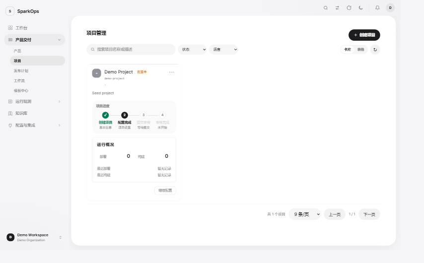
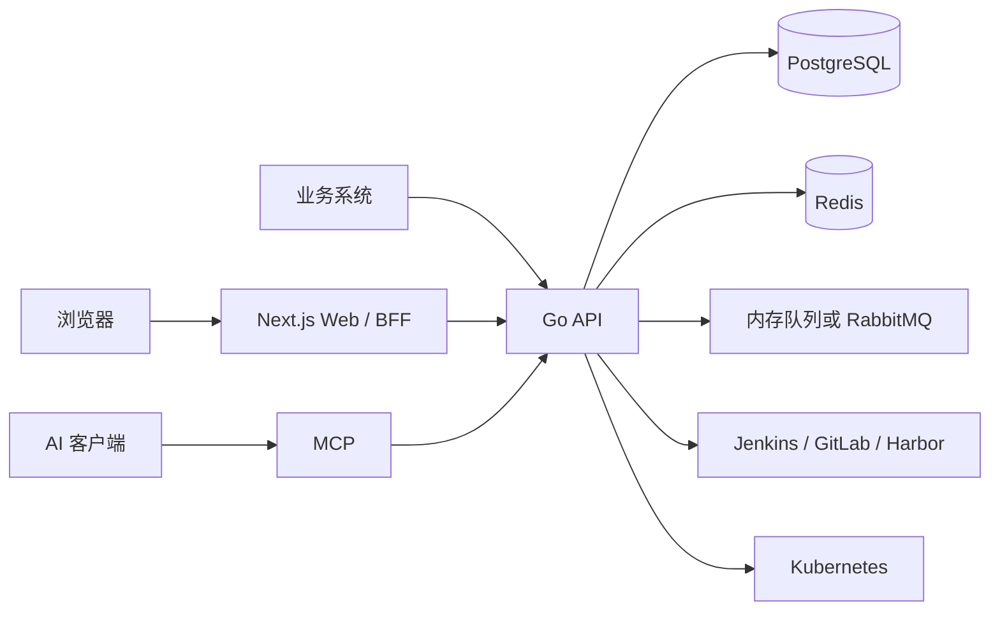

# SparkOps Agent

简体中文 · [English](README_EN.md)

[](LICENSE)
[](backend/go.mod)
[](fronted/package.json)
[](fronted/package.json)

[后端](backend/README.md) · [前端](fronted/README.md) · [Helm](deployments/helm/sparkops/README.md) · [OpenAPI](backend/api/openapi/openapi.yaml)

> 开源的企业级 Agent 控制面。在同一个多租户工作空间里管理 Agent、知识库、持续交付和 Kubernetes 运行，并通过 REST、MCP 与 Webhook 对外集成。

## SparkOps Agent 是什么？

SparkOps Agent 面向需要把 AI 助手和软件交付放在一起治理的团队。

它帮助团队：

- 按组织、工作空间和角色隔离项目、Agent 与集群
- 用知识库和流式对话发布可复用的 Agent
- 把项目从 Jenkins 构建推进到 Kubernetes 部署
- 让外部 AI 客户端通过 MCP 使用平台能力
- 用 Webhook 和 OpenAPI 接入现有系统

## 为什么选择 SparkOps

### 1. 多租户控制面

组织、工作空间、项目和可选的产品组合共用一套身份与 RBAC。平台超管、组织管理员和工作空间成员各自看到自己的资源。

### 2. Agent 与知识

在项目中创建 Agent，绑定知识库，并通过 SSE 进行流式对话。知识检索和对话运行都留在工作空间边界内。

### 3. 交付与运行一体

项目可以绑定 Git、Harbor、Jenkins 和 Kubernetes。构建、部署和 Pod 运维沿同一条项目路径展开，本地也可以用 mock 驱动走完状态流转。

### 4. 三种对外接口

业务系统走 REST / OpenAPI，AI 客户端走 MCP，事件订阅走 Webhook。浏览器只访问 Next.js BFF，BFF 再访问 Go API。

### 5. 企业身份与审计

支持本地账号、OIDC 与 LDAP。关键操作写入审计日志，并提供站内通知。

## 你可以做什么

- 创建组织、工作空间，并按角色授权
- 管理项目，以及把多个项目组合成产品
- 发布 Agent，维护知识库并发起对话
- 触发 Jenkins 构建，跟踪部署直到 Kubernetes
- 查看工作负载、Pod 日志和终端
- 用工作空间 API Token 调用 MCP 工具
- 查看审计记录和站内通知

## 产品路径

### 建立工作空间

注册或使用演示账号登录，进入组织与工作空间，邀请成员并分配角色。

### 准备项目与 Agent

创建项目，配置仓库与集群凭据，再创建 Agent 和知识库。



### 交付到集群

触发构建与部署，在界面或 SSE 中查看 `queued → preparing → building → deploying → succeeded`。

### 接到外部系统

用 OpenAPI 做系统集成，用 MCP 接入 Cursor 等 AI 客户端，用 Webhook 接收平台事件。

## 架构



| 部分 | 说明 |
|------|------|
| API | Go 模块化单体，Gin，默认 `:8080` |
| Web | Next.js BFF，默认 `:3000` |
| 数据 | PostgreSQL、Redis |
| 消息 | 本地可使用内存驱动；生产使用 RabbitMQ |
| 外部系统 | Jenkins、GitLab、Harbor、Kubernetes、SonarQube，按项目按需接入 |

## 快速开始

环境要求：Go 1.26、Node.js 20+、pnpm 9.15.9、PostgreSQL 15、Redis 7。Docker 路径需要 Docker Compose。Helm 的集群要求见 [Helm 文档](deployments/helm/sparkops/README.md)。

### Docker Compose

在仓库根目录执行：

```bash
make docker-up
```

Compose 会启动 PostgreSQL、Redis、RabbitMQ、API 和 Web。这套本地编排默认 `RUNTIME_DRIVER=mock`、`DELIVERY_DRIVER=mock`，用于演示部署与运行流程。

- 界面：http://localhost:3000
- API：http://localhost:8080

停止：`make docker-down`

### 本地开发

准备 PostgreSQL 与 Redis 后：

```bash
cd backend
cp config.example.yaml config.yaml
go run ./cmd/migrate
go run ./cmd/seed
go run ./cmd/server
```

在 `config.yaml` 中填写数据库与 Redis。密码包含 `@` 等特殊字符时，使用配置文件里的结构化 `database` 字段。

```bash
cd fronted
pnpm install
cp apps/web/.env.example apps/web/.env.local
pnpm dev
```

Windows PowerShell 可将 `cp` 换成 `Copy-Item`。

### 演示账号

`go run ./cmd/seed` 会创建 Super Admin：

| 邮箱 | 密码 |
|------|------|
| `demo@sparkops.local` | `Demo1234!` |

该账号只用于本地演示。

## 核心能力

### 身份与治理

- 组织、工作空间、成员与角色
- 平台 Super Admin
- OIDC、LDAP
- 审计日志

### Agent 运行

- Agent 草稿与发布
- 知识库与检索
- SSE 流式对话
- MCP 工具调用

### 交付

- Jenkins 构建
- GitLab、Harbor 凭据绑定
- 部署运行与中止
- 部署阶段事件流

### Kubernetes 运行

- 集群注册与工作空间授权
- 工作负载与 Pod
- 日志与终端

### 统一文件基础设施

- 以 Namespace、Node、Revision、Blob 和 Replica 管理统一文件身份与版本
- 支持 Local/PVC、NFS、S3 Compatible 原生 Provider
- Transfer Session、配额预留、恶意文件扫描、幂等 Commit 与断点续传协议
- File Explorer、Knowledge、Artifact、Agent、Workflow、MCP 和 SFTP 统一使用 File ID
- 生产数据面可拆分为 Transfer Gateway、Worker、SFTP Gateway 和 Reconciler

COS、OSS 和 Azure Blob 为 Adapter 扩展路线，不属于 v1.0 原生 Provider。

### 集成

- REST / OpenAPI
- MCP
- Webhook
- 站内通知

## 目录

| 路径 | 说明 |
|------|------|
| [`backend/`](backend/) | Go API |
| [`fronted/`](fronted/) | Next.js Web 与 BFF |
| [`deployments/helm/sparkops/`](deployments/helm/sparkops/) | Helm Chart |
| [`spec/`](spec/) | 架构说明 |
| [`docs/`](docs/) | 产品与设计文档 |

## 配置与部署

- 后端：[`backend/config.example.yaml`](backend/config.example.yaml)
- 前端：[`fronted/apps/web/.env.example`](fronted/apps/web/.env.example)

生产环境设置 `APP_ENV=production`，将消息驱动设为 `amqp`，并在项目上配置 Jenkins 与 Kubernetes 凭据。本地演示可以设置 `DELIVERY_DRIVER=mock` 与 `RUNTIME_DRIVER=mock`。

```bash
docker build -t your-registry/sparkops/api:1.0.0 -f backend/deployments/docker/Dockerfile backend
docker build -t your-registry/sparkops/web:1.0.0 -f fronted/deployments/docker/Dockerfile fronted
```

Kubernetes 安装步骤见 [Helm 文档](deployments/helm/sparkops/README.md)。开发检查：

```bash
make test
make backend-test
make frontend-test
```

文件系统生产部署、Knowledge 迁移和灾备操作分别见
[部署与运维说明](docs/SparkOps部署与运维说明.md)、
[Knowledge 迁移 Runbook](docs/runbooks/filesystem-knowledge-migration.md) 和
[备份恢复 Runbook](docs/runbooks/filesystem-backup-restore.md)。

OpenAPI 界面：http://localhost:8080/api/docs

## 安全

不要提交 `config.yaml`、`.env.local`、kubeconfig、API Token 或外部系统口令。示例配置中的 `sparkops` 和 `change-me-in-production` 只用于本地演示。

## 贡献

欢迎提交 Issue 与 Pull Request。提交前请运行 `make test`。

## 许可证

本项目采用 [Apache License 2.0](LICENSE)。
