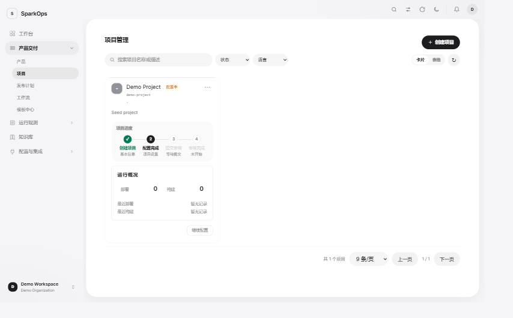
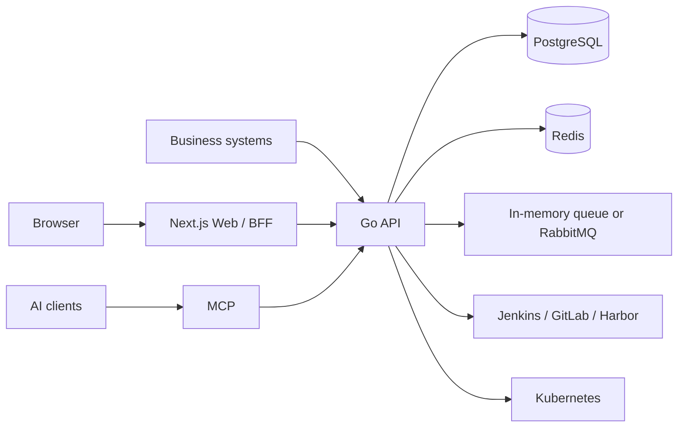

# SparkOps Agent

[简体中文](README.md) · English

[](LICENSE)
[](backend/go.mod)
[](fronted/package.json)
[](fronted/package.json)

[Backend](backend/README.md) · [Frontend](fronted/README.md) · [Helm](deployments/helm/sparkops/README.md) · [OpenAPI](backend/api/openapi/openapi.yaml)

> An open-source enterprise control plane for agents. Manage agents, knowledge, continuous delivery, and Kubernetes runtime in one multi-tenant workspace, and integrate through REST, MCP, and webhooks.

## What is SparkOps Agent?

SparkOps Agent is for teams that need to govern AI assistants and software delivery together.

It helps teams:

- Isolate projects, agents, and clusters by organization, workspace, and role
- Publish reusable agents with knowledge bases and streaming chat
- Move a project from a Jenkins build to a Kubernetes deployment
- Expose platform capabilities to external AI clients through MCP
- Connect existing systems through webhooks and OpenAPI

## Why SparkOps

### 1. A multi-tenant control plane

Organizations, workspaces, projects, and an optional product grouping share one identity and RBAC model. Platform super admins, organization admins, and workspace members each see their own resources.

### 2. Agents and knowledge

Create agents inside a project, attach knowledge bases, and chat over SSE. Retrieval and chat runs stay inside the workspace boundary.

### 3. Delivery and runtime on one path

A project can bind Git, Harbor, Jenkins, and Kubernetes. Builds, deployments, and pod operations follow the same project. A local mock driver can still walk the full state flow.

### 4. Three integration surfaces

Business systems use REST / OpenAPI. AI clients use MCP. Event subscribers use webhooks. The browser talks to the Next.js BFF, and the BFF calls the Go API.

### 5. Enterprise identity and audit

Local accounts, OIDC, and LDAP are supported. Sensitive actions are written to the audit log, with in-app notifications.

## What you can do

- Create organizations and workspaces, then grant roles
- Manage projects, and group projects into a product
- Publish agents, maintain knowledge bases, and start chats
- Trigger Jenkins builds and follow a deployment onto Kubernetes
- Inspect workloads, pod logs, and terminals
- Call MCP tools with a workspace API token
- Read audit records and in-app notifications

## Product workflow

### Open a workspace

Sign in, or use the demo account. Enter an organization and workspace, invite members, and assign roles.

### Prepare a project and agents

Create a project, configure repository and cluster credentials, then create agents and knowledge bases.



### Deliver to a cluster

Trigger a build and deployment. Follow `queued → preparing → building → deploying → succeeded` in the UI or over SSE.

### Connect outside systems

Use OpenAPI for system integration, MCP for AI clients such as Cursor, and webhooks for platform events.

## Architecture



| Part | Description |
|------|-------------|
| API | Modular Go monolith, Gin, `:8080` by default |
| Web | Next.js BFF, `:3000` by default |
| Data | PostgreSQL and Redis |
| Messaging | In-memory driver for local development; RabbitMQ in production |
| External systems | Jenkins, GitLab, Harbor, Kubernetes, and SonarQube, connected per project when needed |

## Quick start

Requirements: Go 1.26, Node.js 20+, pnpm 9.15.9, PostgreSQL 15, and Redis 7. The Docker path needs Docker Compose. Cluster requirements for Helm are in the [Helm guide](deployments/helm/sparkops/README.md).

### Docker Compose

From the repository root:

```bash
make docker-up
```

Compose starts PostgreSQL, Redis, RabbitMQ, the API, and the web app. This local stack defaults to `RUNTIME_DRIVER=mock` and `DELIVERY_DRIVER=mock` so the deployment and runtime flow can be demonstrated locally.

- UI: http://localhost:3000
- API: http://localhost:8080

Stop the stack with `make docker-down`.

### Local development

With PostgreSQL and Redis available:

```bash
cd backend
cp config.example.yaml config.yaml
go run ./cmd/migrate
go run ./cmd/seed
go run ./cmd/server
```

Fill in the database and Redis settings in `config.yaml`. When a password contains `@` or another reserved character, use the structured `database` fields in that file.

```bash
cd fronted
pnpm install
cp apps/web/.env.example apps/web/.env.local
pnpm dev
```

On Windows PowerShell, use `Copy-Item` instead of `cp`.

### Demo account

`go run ./cmd/seed` creates a Super Admin:

| Email | Password |
|-------|----------|
| `demo@sparkops.local` | `Demo1234!` |

Use this account for local demonstration only.

## Core capabilities

### Identity and governance

- Organizations, workspaces, members, and roles
- Platform Super Admin
- OIDC and LDAP
- Audit logs

### Agent runtime

- Agent drafts and publishing
- Knowledge bases and retrieval
- Streaming chat over SSE
- MCP tool calls

### Delivery

- Jenkins builds
- GitLab and Harbor credential binding
- Deployment runs and abort
- Deployment stage event stream

### Kubernetes runtime

- Cluster registration and workspace authorization
- Workloads and pods
- Logs and terminal

### Integration

- REST / OpenAPI
- MCP
- Webhooks
- In-app notifications

## Layout

| Path | Description |
|------|-------------|
| [`backend/`](backend/) | Go API |
| [`fronted/`](fronted/) | Next.js web app and BFF |
| [`deployments/helm/sparkops/`](deployments/helm/sparkops/) | Helm chart |
| [`spec/`](spec/) | Architecture notes |
| [`docs/`](docs/) | Product and design documents |

## Configuration and deployment

- API: [`backend/config.example.yaml`](backend/config.example.yaml)
- Web: [`fronted/apps/web/.env.example`](fronted/apps/web/.env.example)

In production, set `APP_ENV=production`, set the messaging driver to `amqp`, and configure project-level Jenkins and Kubernetes credentials. For a local demonstration, set `DELIVERY_DRIVER=mock` and `RUNTIME_DRIVER=mock`.

```bash
docker build -t your-registry/sparkops/api:1.0.0 -f backend/deployments/docker/Dockerfile backend
docker build -t your-registry/sparkops/web:1.0.0 -f fronted/deployments/docker/Dockerfile fronted
```

Kubernetes install steps are in the [Helm guide](deployments/helm/sparkops/README.md). Development checks:

```bash
make test
make backend-test
make frontend-test
```

OpenAPI UI: http://localhost:8080/api/docs

## Security

Keep `config.yaml`, `.env.local`, kubeconfig files, API tokens, and external-system passwords out of Git. The sample values `sparkops` and `change-me-in-production` are for local demonstration.

## Contributing

Issues and pull requests are welcome. Run `make test` before submitting.

## License

SparkOps Agent is licensed under the [Apache License 2.0](LICENSE).
