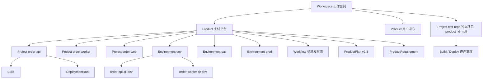

# SparkOps 产品（Product）设计方案 v2

> **Project 保留 · 可独立存在 · Product 可选组合多个 Project**  
> 参考：[Zadig 文档](https://docs.koderover.com/zadig) · [Zadig 核心概念](https://docs.koderover.com/zadig/cn/Zadig%20v4.3/quick-start/concepts/) · [Zadig 项目列表](https://course.koderover.com/v1/projects)  
> **源码对标**：本仓库 [`plugins/zadig`](../../plugins/zadig)（Zadig v2 上游 aslan 核心域），详见 **附录 B**  
> **开发方案**：[product_implementation_plan.md](./product_implementation_plan.md)（M0–M9 Milestone、Sprint 拆分、API/DDL 清单）

---

## 1. 核心定位


| 层级     | SparkOps 实体 | 用户可见名称 | 对标 Zadig        | 职责                             |
| ------ | ----------- | ------ | --------------- | ------------------------------ |
| 租户     | Workspace   | 工作空间   | —               | 协作与资源边界                        |
| **容器** | **Product** | **产品** | **Project（项目）** | 业务交付单元，组合多个 Project            |
| **单元** | **Project** | **项目** | **Service（服务）** | 单个可部署应用；**可独立存在**，也可归属 Product |
| 运行     | Environment | 环境     | Environment     | 一组 Project 在某集群/Namespace 的实例  |
| 流程     | Workflow    | 工作流    | Workflow        | 跨 Project 的构建→部署→发布编排          |


**一句话**：

> **Product = 产品系统（Zadig 项目）**，用于组合多个 Project；**Project = 可独立存在的可部署单元**，也可选择归属某个 Product。名称不变，Product 为**可选增强层**。

**设计原则：Project 独立优先**


| 原则            | 说明                                            |
| ------------- | --------------------------------------------- |
| Project 可单独存在 | `product_id` 为**可选**字段，NULL 表示独立项目，能力与现网一致    |
| Product 为组合层  | 多个 Project 需要统一环境/工作流/发布治理时，才归入 Product       |
| 不强制归属         | 创建 Project 时可不选 Product；已有 Project 可不迁移、不自动回填 |
| 双向可选          | Project 可随时「加入产品」或「移出产品」，移出后恢复独立运行            |


---

## 2. 与 Zadig 的对照关系

依据 [Zadig 核心概念](https://docs.koderover.com/zadig/cn/Zadig%20v4.3/quick-start/concepts/) 与 [项目实施手册](https://docs.koderover.com/zadig/cn/Zadig%20v4.3/project-manual/)：

```
Zadig                          SparkOps（v2）
─────────────────────────────────────────────
Project（业务单元）      →     Product（产品）
  ├── Service A          →       ├── Project A
  ├── Service B          →       ├── Project B
  ├── Environment dev    →       ├── Environment dev
  ├── Workflow           →       ├── Workflow
  └── Build / Version    →       └── Plan / Requirement / ReleaseFlow
```

**刻意保留的差异命名**：

- SparkOps 叫 **Product**，Zadig 叫 Project —— 避免与 SparkOps **Project** 命名冲突
- SparkOps 叫 **Project**，语义上接近 Zadig Service，但**不改名**，减少迁移成本

### 2.1 Zadig 源码命名陷阱（读 `plugins/zadig` 时必看）

Zadig **UI/文档命名 ≠ Go 代码命名**，同一单词 `Product` 在源码中有两种含义：

| Zadig UI/文档 | Zadig 源码类型 | 源码路径 | SparkOps 对应 |
|--------------|---------------|---------|--------------|
| **Project（项目/业务单元）** | `template.Product` | `pkg/.../models/template/product.go` | **Product** |
| **Environment（环境）** | `models.Product` | `pkg/.../models/product.go` | **Environment** |
| **Service（服务）** | Service 模板 + `ProductService` | `pkg/.../service/` | **Project** |
| **Workflow** | `WorkflowV4` | `pkg/.../models/workflow_v4.go` | **ProductWorkflow** |
| **Workflow 模板** | `WorkflowV4Template` | `pkg/.../models/workflow_template.go` | **WorkflowTemplate** |
| **ReleasePlan** | `ReleasePlan` | `pkg/.../models/release_plan.go` | **ReleasePlan** |
| **Build** | `models.Build` | `pkg/.../build/` | Project 构建配置 |

**关键 API 前缀**（aslan `:25000`）：

| 路由 | 域 |
|------|-----|
| `/api/project` | 项目模板（= SparkOps Product） |
| `/api/environment` | 环境实例（= SparkOps Environment） |
| `/api/workflow/v4` | 工作流 CRUD + 执行 |
| `/api/workflow/v4/global` | 全局工作流页（portal key: `releaseWorkflow`） |
| `/api/release_plan/v1` | 发布计划 |
| `/api/template` | 模板库（workflow / build / yaml / release_plan 等） |

---

## 3. 领域模型

### 3.1 Product（产品 — 容器）

```typescript
Product {
  id: UUID
  workspace_id: UUID
  name: string              // 唯一标识，如 payment-platform
  display_name: string      // 展示名，如「支付平台」
  description: string
  product_type: "k8s_yaml" | "k8s_helm" | "mixed"   // 产品类型
  status: "active" | "archived"
  global_variables: Record<string, string>          // 产品级全局变量
  release_flow_id?: UUID                            // 产品级默认发布链（审批策略）
  default_workflow_id?: UUID                        // 产品级默认工作流（§24.7）
  created_by, created_at, updated_at
}
```

**Product 拥有（聚合根）**：


| 子资源                | 关系         | 说明                                    |
| ------------------ | ---------- | ------------------------------------- |
| Project            | 0..N（可选归属） | 产品下的可部署项目；未归属 Product 的 Project 为独立项目 |
| Environment        | 1:N        | 产品级环境（dev/uat/prod）                   |
| Workflow           | 1:N        | 产品级工作流                                |
| ProductPlan        | 1:N        | 迭代计划（已有）                              |
| ProductRequirement | 1:N        | 发布需求（已有，已含 project_id）                |
| ProductMember      | 1:N        | 产品级成员与权限                              |


### 3.2 Project（项目 — 保留，增加归属）

```typescript
Project {
  // ===== 现有字段全部保留 =====
  id, workspace_id, name, display_name, git_url, language,
  template_id, resources, review_status, default_cluster_id, ...

  // ===== 新增（均可选）=====
  product_id?: UUID | null   // 所属产品；null = 独立项目（长期合法状态，非过渡态）
  sort_order?: number        // 在产品内的排序（仅 product_id 有值时生效）
}
```

**Project 职责不变**：

- Git 配置、模板渲染、Jenkins 构建、K8s 部署
- 审核门禁（review_status）
- 项目成员（project_members）
- 详情 Tab：概览 / Build日志 / ConfigMap / 监控 等

**两种存在形态**：


| 形态        | `product_id` | 部署方式                                                 | 适用场景          |
| --------- | ------------ | ---------------------------------------------------- | ------------- |
| **独立项目**  | `null`       | 直接选集群（`default_cluster_id`），与现网一致                    | 单应用、快速接入、PoC  |
| **产品内项目** | 有值           | 可走 Product Environment / Workflow，也可 fallback 到集群直部署 | 多项目系统、统一环境/发布 |


Workspace 仍是租户边界；Product **不是** Project 的前置条件。

### 3.3 ProductProject 关联

**规则**：

- `product_id` **nullable**，独立 Project 无需创建 Product
- 一个 Project 最多归属 **一个** Product（1:0..1 关系）
- 加入/移出 Product 不影响 Project 自身配置与部署历史

若后期需多产品共享同一 Project（少见），可引入关联表：

```sql
product_project_bindings (
  product_id, project_id, role: "primary" | "shared", sort_order
)
```

### 3.4 Environment（环境 — 产品级）

```typescript
Environment {
  id, product_id, workspace_id
  name: string              // dev / sit / uat / prod
  env_type: "test" | "production"
  cluster_id: UUID          // 绑定授权集群
  namespace: string         // K8s Namespace（1:1）
  variables: Record<string, string>   // 覆盖 Product.global_variables
  status: "active" | "disabled"
}

EnvironmentProject {        // 某环境下各 Project 的部署态
  environment_id, project_id
  enabled: boolean
  current_image_tag?: string
  current_deployment_run_id?: UUID
  last_deployed_at?: timestamp
}
```

对齐 [Zadig 多环境配置](https://docs.koderover.com/zadig/cn/Zadig%20v4.3/env/multi-env/)：同一套 Project 模板，在不同 Environment 使用不同变量/镜像。

### 3.5 Workflow（工作流 — 抽象 + 模板 + 产品实例）

> 详细设计见 **Part 3**（§23–§31，Workflow 抽象 + 模板 + 实例），对标 [Zadig 工作流配置](https://docs.koderover.com/zadig/cn/Zadig%20v4.3/project/common-workflow/) · [全局工作流页](https://course.koderover.com/v1/releaseWorkflow)

**核心思想：Workflow 是一种可复用的编排抽象**

```
WorkflowSchema（抽象元素定义）
      ↑ 实例化
WorkflowTemplate（模板：系统 / Workspace 级，可复用）
      ↑ 挂载 + 绑定槽位
ProductWorkflow（产品实例：来自模板 或 完全自定义）
      ↑ 执行
ProductWorkflowRun（一次运行）
```


| 层级  | 实体                     | 说明                                |
| --- | ---------------------- | --------------------------------- |
| 抽象  | **WorkflowSchema**     | 阶段、任务、变量、触发器的类型系统（§24.1）          |
| 模板  | **WorkflowTemplate**   | 可复用蓝图；含占位槽位 `{{slot.*}}`（§24.2）   |
| 实例  | **ProductWorkflow**    | Product 挂载模板或自定义；可执行、可改（§24.3）    |
| 运行  | **ProductWorkflowRun** | 一次执行快照（§24.5）                     |
| 遗留  | **Project Workflow**   | `project_id` 现有轻量流程；独立 Project 保留 |


**Product 如何使用 Workflow**：

1. **挂模板**：从模板库选「标准预发布流」→ 绑定本产品的 Project / Environment → 生成可执行实例
2. **自定义**：空白创建 ProductWorkflow，自由编排阶段与任务
3. **默认工作流**：`Product.default_workflow_id` 指向主发布流；ReleasePlan / 全局工作流页一键执行

与现有能力衔接（Phase W1 最小 Job 集）：


| Job 类型              | 对接                  |
| ------------------- | ------------------- |
| `sparkops-build`    | `delivery.builds`   |
| `sparkops-deploy`   | `deployment_runs`   |
| `sparkops-approval` | 站内审批；ReleasePlan 共用 |


---

## 4. 层级关系




---

## 5. UI / 导航设计

参考 [Zadig 项目页](https://course.koderover.com/v1/projects)，在 SparkOps 中拆成两级入口。

### 5.1 产品列表 `/products`

```
┌────────────────────────────────────────────────────────┐
│  产品管理                              [+ 创建产品]     │
│  管理业务产品，组合多个项目实现持续交付                  │
├────────────────────────────────────────────────────────┤
│  🔍 搜索    类型 ▼    状态 ▼                           │
├────────────────────────────────────────────────────────┤
│  ┌─────────────────┐  ┌─────────────────┐              │
│  │ 支付平台         │  │ 用户中心         │              │
│  │ K8s YAML · 3项目 │  │ Mixed · 2项目   │              │
│  │ 3环境 · 2h前发布 │  │ 2环境 · 1d前发布 │              │
│  └─────────────────┘  └─────────────────┘              │
└────────────────────────────────────────────────────────┘
```

### 5.2 产品详情 `/products/:productId`


| Tab     | 内容                               | 复用现有                                                                        |
| ------- | -------------------------------- | --------------------------------------------------------------------------- |
| **概览**  | 项目数、环境数、各环境部署版本矩阵、最近工作流          | 部分复用 ProjectEnvironmentStatus                                               |
| **项目**  | Product 下 Project 卡片列表           | 复用 ProjectCard / ProjectPanel                                               |
| **环境**  | dev/uat/prod 环境管理 + 变量           | 新建                                                                          |
| **工作流** | 工作流列表 + 可视化编排 + 执行历史             | 对标 [releaseWorkflow](https://course.koderover.com/v1/releaseWorkflow)，见 §28 |
| **发布**  | ProductPlan + ProductRequirement | 复用 /publish/plans、/publish/releases                                         |
| **设置**  | 全局变量、ReleaseFlow 绑定、成员           | 新建 + 已有 RBAC                                                                |


### 5.3 项目详情 `/projects/:projectId`（保持不变）

- 路由、Tab、工作台**不改**
- **独立项目**：面包屑仅 `项目 / test-repo`，不展示产品层级
- **产品内项目**：面包屑 `产品 / 支付平台 / order-api`
- 项目配置页增加「所属产品」选择器：**可选 / 可清空**（清空即恢复独立项目）

### 5.4 导航调整

```
应用中心
  ├── 产品管理          /products          ← 新增主入口（Zadig 项目列表）
  ├── 项目管理          /projects          ← 保留（Workspace 全量项目视图）
  └── 模板管理          /templates

持续交付
  ├── 产品管理          （可合并到 /products，或保留快捷入口）
  └── Pipeline Studio   /delivery/pipelines
```

**双入口策略**：

- `/products` — 按产品组织（多项目系统推荐路径）
- `/projects` — **Workspace 全量项目**（含独立项目 + 产品内项目，与现网一致，独立项目主入口）

**项目列表筛选**：

- 全部项目
- 独立项目（`product_id IS NULL`）
- 按产品筛选

---

## 6. 与现有模块整合

### 6.1 ProductRequirement（已有 project_id）

```
Product
  └── ProductPlan（迭代）
        └── ProductRequirement
              ├── product_id（已有）
              ├── project_id（已有）→ 指定哪个 Project 构建
              └── 扩展：workflow_run_id → 整产品多 Project 联合发布
```

- **单 Project 发布**（现状）：Requirement → 触发单个 Project Build
- **多 Project 发布**（新增）：ReleasePlan 审批 → workflow Job 触发 Product Workflow → 按阶段 build/deploy 多个 Project（§24.5、§30）

### 6.2 部署模型调整


| 场景              | 部署路径                                                     |
| --------------- | -------------------------------------------------------- |
| **独立 Project**  | 保持现状：`DeploymentRun(project_id, cluster_id)`，发布向导选集群     |
| **产品内 Project** | 优先选 **Environment** 部署；未配置 Environment 时 fallback 到集群直部署 |
| 数据模型            | `deployment_runs.environment_id` **可选**；NULL 表示集群直部署     |


| UI            | 目标                                           |
| ------------- | -------------------------------------------- |
| 独立 Project 卡片 | 继续展示集群维度「环境部署」（现 `ProjectEnvironmentStatus`） |
| 产品概览          | 展示 **Product × Environment × Project** 矩阵    |


### 6.3 ReleaseFlow

绑定层级调整为 **Product 级**（参见 `docs/superpowers/plans/2026-09-03-release-flow.md`）：

```
Product.release_flow_id  →  产品默认发布链（uat → prod）
Environment.approval_override  →  prod 环境强制 before_deploy 审核
Project.default_cluster_id  →  Environment 未配置时的 fallback
```

### 6.4 权限

```
ProductMember（新增）
  product:admin | product:developer | product:viewer

ProjectMember（保留）
  继承 Product 权限，或可细化到单 Project
```

规则：

- 独立 Project：仅校验 **ProjectMember** / Workspace 权限（与现网一致）
- 产品内 Project：Product 权限 **或** Project 成员均可访问
- 有 Product 权限 → 可访问其下所有 Project；Project 成员可单独追加

---

## 7. 数据模型变更

### Phase 1（最小可行）

```sql
-- 1. 扩展 products 表
ALTER TABLE product.products ADD COLUMN product_type VARCHAR(32) DEFAULT 'k8s_yaml';
ALTER TABLE product.products ADD COLUMN global_variables JSONB DEFAULT '{}';
ALTER TABLE product.products ADD COLUMN release_flow_id UUID;
ALTER TABLE product.products ADD COLUMN status VARCHAR(16) DEFAULT 'active';

-- 2. Project 可选归属 Product（NULL = 独立项目）
ALTER TABLE workspace_app.projects ADD COLUMN product_id UUID NULL REFERENCES product.products(id);
CREATE INDEX idx_projects_product_id ON workspace_app.projects(product_id);
-- 注意：不做 NOT NULL 约束，不做强制回填

-- 3. 产品成员（可选 Phase 1）
CREATE TABLE product.product_members (
  product_id UUID NOT NULL,
  member_id UUID NOT NULL,
  role VARCHAR(32) NOT NULL,
  PRIMARY KEY (product_id, member_id)
);
```

### Phase 2（环境）

```sql
CREATE TABLE product.environments (...);
CREATE TABLE product.environment_projects (...);
ALTER TABLE delivery.deployment_runs ADD COLUMN environment_id UUID;
```

### Phase 3（工作流）

```sql
-- 详见 §29.2 ProductWorkflow / ProductWorkflowRun
CREATE TABLE product.product_workflows (...);
CREATE TABLE product.product_workflow_runs (...);
-- 与现有 workflow.workflows（Project 级）共存
```

---

## 8. API 设计

```
# 产品
GET    /workspaces/:wsId/products
POST   /workspaces/:wsId/products
GET    /products/:productId
PATCH  /products/:productId
GET    /products/:productId/overview          # 概览：项目/环境/部署矩阵

# 产品下的项目（Project 不变，增加过滤）
GET    /products/:productId/projects
POST   /products/:productId/projects          # 创建并自动关联 product_id
POST   /workspaces/:wsId/projects             # 创建独立项目（product_id 省略或为 null）
PATCH  /projects/:projectId                   # product_id 可设置、可清空（null = 独立）

# 环境
GET    /products/:productId/environments
POST   /products/:productId/environments
GET    /products/:productId/environments/:envId/status   # 各 Project 部署态

# 工作流
GET    /products/:productId/workflows
POST   /products/:productId/workflows/:wfId/run

# 现有 Project API 全部保留，向后兼容
GET    /workspaces/:wsId/projects             # 仍返回 Workspace 下全部 Project
```

---

## 9. 分阶段实施

### Phase 1：Product ↔ Project 关联（2–3 周）

- `projects.product_id` **nullable** 字段（不强制回填、不自动创建默认 Product）
- 产品 CRUD API + 产品列表/详情页（项目 Tab 嵌入 ProjectCard）
- 创建 Project：**所属产品为可选字段**（默认独立项目）
- 项目配置：支持「加入产品 / 移出产品」
- 项目详情面包屑：独立项目不展示产品层级
- `/projects` 保留，增加「所属产品」列与筛选（含「独立项目」筛选项）

**交付标准**：

1. 可不创建 Product，独立 Project 全流程与现网一致
2. 可创建 Product，将多个 Project 归入同一 Product
3. 已归属 Product 的 Project 可移出，恢复独立状态

### Phase 2：Environment（3–4 周）

- Environment 实体 + CRUD
- 产品「环境 Tab」：dev/uat/prod + 变量配置
- 部署向导：选 Environment 而非裸集群
- 产品概览：Environment × Project 部署版本矩阵

### Phase 3：Workflow + 发布整合（4–6 周）

- Product 级 Workflow
- ProductRequirement 可触发整产品工作流
- ReleaseFlow 绑定到 Product
- 发布 Tab 迁入产品详情（合并 /publish）

### Phase 4：体验增强（可选）

- 产品模板（从模板一键创建 Product + N 个 Project）
- 产品级监控大盘
- Helm 类型产品

---

## 10. 迁移与兼容


| 场景                      | 策略                                       |
| ----------------------- | ---------------------------------------- |
| 现有 Project 无 product_id | **保持独立**，不自动创建默认 Product、不强制回填           |
| 用户希望组合多项目               | 手动创建 Product，再将 Project 加入               |
| 现有 Product（发布工单）        | 保留 Plan/Requirement，升级为容器语义              |
| API 兼容                  | `/projects/`* 路径不变；`product_id` 永久可选     |
| UI 兼容                   | `/projects` 为独立项目主入口；`/products` 为组合治理入口 |


---

## 11. 关键决策


| 决策项                     | 推荐方案                                             |
| ----------------------- | ------------------------------------------------ |
| Product 中文名             | UI 用「**产品**」，与 Project「**项目**」区分                 |
| Project 是否必须归属 Product  | **否**；`product_id` 永久可选，独立项目为一等公民                |
| Project 与 Product 关系    | 最多 **1 Project : 0..1 Product**；移出 Product 后恢复独立 |
| 独立 Project 部署           | 继续集群直部署，不依赖 Product / Environment                |
| Environment 与 Namespace | 仅 **产品内 Project** 使用；独立 Project 不走 Environment   |
| ProductPlan             | 保留为迭代/版本分组；可选关联 ReleasePlan                      |
| ProductRequirement      | **重构为 ReleasePlan（发布计划）**；见 §13                  |


---

## 12. 总结


| 原则               | 说明                                                   |
| ---------------- | ---------------------------------------------------- |
| **Project 独立优先** | Project 可单独存在，不依赖 Product                            |
| **Project 不动**   | 名称、路由、工作台、独立项目构建部署逻辑全部保留                             |
| **Product 可选**   | Product 是组合与治理增强层，非强制前置                              |
| **组合关系**         | `Product 1 ── N Project`（可选归属，`product_id` nullable） |
| **环境/工作流**       | 挂在 Product 上；独立 Project 仍用集群直部署                      |
| **渐进增强**         | 需要时再创建 Product、加入 Environment/Workflow，零强制迁移         |


---

## 附录：SparkOps 现状对照（迁移前）


| SparkOps 现状                  | 本方案目标                                         |
| ---------------------------- | --------------------------------------------- |
| Project = 可部署应用单元            | Project 保留，**可独立**或可选 `product_id`            |
| Product = 发布计划/需求工单          | Product 升级为业务交付容器；Requirement 升级为 ReleasePlan |
| Environment = Workspace 授权集群 | Environment 独立实体，产品级                          |
| Fleet/Pipeline = 前端 Mock     | Workflow 后端落地，挂 Product                       |
| `/projects` 为主入口             | `/products` + `/projects` 双入口                 |


---

# Part 2：发布计划重构（ProductRequirement → ReleasePlan）

> 对标：[Zadig 发布计划 v4.3](https://docs.koderover.com/zadig/cn/Zadig%20v4.3/release/plan/) · [发布计划详情页（规划态）](https://course.koderover.com/v1/releasePlan/detail?operation=planning&id=6a98e14e8a62a1055ffa8287&name=%E6%B5%8B%E8%AF%95%E5%8F%91%E5%B8%83%E8%AE%A1%E5%88%92)

---

## 13. 重构动机

### 13.1 现状（ProductRequirement）

当前 `product.product_requirements` 本质是**单项目发布工单**：


| 维度  | 现状                                                   | 问题                        |
| --- | ---------------------------------------------------- | ------------------------- |
| 粒度  | 一条记录 = 一个 Project + 一个分支                             | 无法编排多服务/多步骤发布             |
| 流程  | `pending → approved → release → running → completed` | 无「规划期」、无发布窗口、无定时执行        |
| 执行  | `release` 触发单 Project Jenkins Build                  | 与 Product Workflow 未打通    |
| UI  | `/publish/releases` 表格 + 批准/驳回/发布                    | 无详情页、无发布项 checklist、无操作记录 |
| 审批  | 单条工单级 approve/reject                                 | 无计划级审批、无审批配置              |


```go
// 现状：一条 Requirement 绑定单 Project，release 只触发一次 Build
ProductRequirement {
  product_id, product_plan_id?, project_id, project_tag,
  status: pending|approved|rejected|running|completed
}
```

### 13.2 目标（对标 Zadig ReleasePlan）

Zadig **发布计划**是产品级发布编排文档，核心能力：

1. **规划期（planning）**：草稿编辑，配置发布项、负责人、发布窗口
2. **审批期**：完成规划 → 提交审批 → 通过/驳回/超时
3. **执行期（executing）**：在发布窗口内逐项执行发布项（工作流 / 文本 checklist）
4. **收尾**：全部完成或跳过 → 计划成功；支持取消、超时

**SparkOps 映射原则**（对照 `plugins/zadig/.../release_plan.go`）：


| Zadig 源码 | SparkOps v2 | SparkOps 增强 / 差异 |
|-----------|-------------|---------------------|
| `ReleasePlan` | **ReleasePlan** | SparkOps 增加 `product_id`（Zadig 为**租户级全局**，无 product 外键） |
| `ReleaseJob[]`（内嵌 Mongo 数组） | **ReleasePlanJob**（独立表 + `sort_order`） | 语义一致；SparkOps 关系型拆表便于查询 |
| `TextReleaseJobSpec` | text Job | `content` + `remark` |
| `WorkflowReleaseJobSpec` | workflow Job | 见下方「快照 vs 引用」 |
| `ReleasePlanTemplate` | ReleasePlan 模板 | Phase R4；对标 `/api/template` release_plan |
| `ReleasePlanLog` / Version | `ReleasePlanAuditLog` + 版本快照 | Phase R4 |

**workflow 类型发布项：Zadig 快照 vs SparkOps 双模式**

Zadig 在规划期将 **完整 `WorkflowV4` 嵌入** Job Spec（`WorkflowReleaseJobSpec.Workflow`），执行后写入 `TaskID`：

```go
// plugins/zadig/.../release_plan.go
type WorkflowReleaseJobSpec struct {
    Workflow *WorkflowV4   // 规划态内嵌工作流定义快照
    TaskID   int64         // 执行后关联 WorkflowTask
}
```

SparkOps 采用 **引用 + 可选快照**：

| 模式 | 字段 | 场景 |
|------|------|------|
| **引用模式（默认）** | `workflow_id` → ProductWorkflow | 与产品工作流库联动；ReleasePlan 执行时创建 Run |
| **快照模式（规划锁定）** | `workflow_snapshot: WorkflowDefinition` | 对标 Zadig；规划完成后冻结定义，不受后续 Workflow 修改影响 |

Phase R2 先实现引用模式；R4 补充快照模式（finish_planning 时 materialize）。

---

## 14. 领域模型

### 14.1 ReleasePlan（发布计划 — 聚合根）

```typescript
ReleasePlan {
  id: UUID
  product_id: UUID                    // SparkOps 增强：Zadig 无此字段（租户级全局）
  product_plan_id?: UUID              // 可选：关联 ProductPlan / Jira Sprint
  index: number                       // 展示序号（对标 ReleasePlan.Index）
  version: number                     // 版本号（对标 ReleasePlan.Version）
  name: string
  description?: string
  manager_id: UUID                    // 对标 ManagerID
  approver_id?: UUID                  // 对标 ApproverID
  status: ReleasePlanStatus           // 见 §14.3
  start_time: ISO8601                  // 对标 StartTime（Unix ms）
  end_time: ISO8601                   // 对标 EndTime
  schedule_execute_time?: ISO8601     // 对标 ScheduleExecuteTime
  approval?: Approval                 // native | lark | dingtalk | workwx（Phase R3）
  jobs: ReleasePlanJob[]              // Zadig 内嵌；SparkOps 独立表 + 逻辑等价
  hook_settings?: HookSettings         // Phase R4：外部系统回调
  jira_sprint_association?: object    // Phase R4
  // 里程碑时间戳（对标 Zadig）
  planning_time?, finish_planning_time?, approval_time?, executing_time?, success_time?
  created_by, created_at, updated_by, updated_at
}
```

**与 Product v2 对齐**：

- ReleasePlan **必须**归属 Product（组合治理场景）
- 独立 Project 不走 ReleasePlan，仍用项目工作台「发布」直部署
- 可选 `product_plan_id` 将发布计划归入某次迭代（ProductPlan 保留为版本/迭代容器）

### 14.2 ReleasePlanJob（发布项）

```typescript
ReleasePlanJob {
  id: UUID
  release_plan_id: UUID
  sort_order: number                  // 执行顺序
  name: string                        // 发布项名称
  type: "text" | "workflow"           // 对标 Zadig job type
  owner_id: UUID                      // 负责人
  status: ReleasePlanJobStatus        // 见 §14.4

  // type = "text"：人工 checklist（发布前检查、回滚预案等）
  text_content?: string               // 富文本 / Markdown
  text_checked?: boolean              // 执行期勾选完成

  // type = "workflow"（对标 WorkflowReleaseJobSpec）
  workflow_spec?: {
    mode: "reference" | "snapshot"    // 默认 reference
    workflow_id?: UUID                // reference 模式：ProductWorkflow ID
    workflow_snapshot?: WorkflowDefinition  // snapshot 模式：规划态冻结
    parameters?: Record<string, string>     // 运行时变量覆盖
  }
  runtime?: {                         // 对标 ReleaseJobRuntime（内联）
    last_status?: ReleasePlanJobStatus  // 回到 planning 时保留上次状态
    updated?: boolean
    executed_by?: UUID
    executed_at?: ISO8601
  }
  execution_ref?: {
    workflow_run_id?: UUID           // ProductWorkflowRun ID（对标 TaskID）
    build_id?: UUID                  // 单 Project fallback
    error_message?: string
  }
}
```

**Job 类型说明**：


| 类型         | 用途                                 | 执行方式               |
| ---------- | ---------------------------------- | ------------------ |
| `text`     | 发布检查清单、沟通事项、人工确认步骤                 | 负责人在执行期勾选「完成」或「跳过」 |
| `workflow` | 构建部署某 Project / 跑 Product Workflow | 系统自动触发；失败可重试       |


**与现状 Requirement 的对应**：

- 旧 `ProductRequirement` 的一条记录 → 迁移为 **含 1 个 workflow 类型 Job 的 ReleasePlan**
- 旧字段映射：`project_id` → job.workflow_ref.project_id；`project_tag` → branch；`build_id` → execution_ref.build_id

### 14.3 ReleasePlan 状态机

```
                    ┌─────────────┐
                    │  planning   │  草稿，可编辑发布项
                    └──────┬──────┘
                           │ finish_planning（完成规划）
                           ▼
              ┌────────────────────────┐
              │  wait_for_approval     │  已提交，待审批（approval.enabled=true）
              └──────────┬─────────────┘
         denied ◄────────┼────────► approved
              │          │              │
              ▼          │ timeout      │（或 approval.disabled 直接跳过）
         ┌─────────┐     │              │
         │ denied  │     ▼              ▼
         └─────────┘  timeout      ┌─────────────┐
                                   │  executing  │  窗口内执行发布项
                                   └──────┬──────┘
                          cancel ◄───────┼───────► success
                              │          │
                              ▼          ▼
                         ┌─────────┐  ┌─────────┐
                         │ cancel  │  │ success │
                         └─────────┘  └─────────┘
```


| 状态                  | 中文   | 允许操作                 |
| ------------------- | ---- | -------------------- |
| `planning`          | 规划中  | 编辑、添加/删除 Job、完成规划    |
| `wait_for_approval` | 待审批  | 审批通过、驳回、撤回           |
| `executing`         | 执行中  | 执行/跳过 Job、取消计划       |
| `success`           | 已完成  | 只读                   |
| `denied`            | 已驳回  | 只读或回到 planning（重新编辑） |
| `finish_planning`   | 规划完成 | 过渡态；可触发 external_check（Phase R4） |
| `timeout`           | 超时   | 审批超时或**发布窗口超时**（Zadig 分两种 timeout） |
| `cancel`            | 已取消  | 只读                   |

**Zadig 扩展状态（Phase R4 可选）** — 源码 `ReleasePlanStatus` 共 13+ 态：

| 状态 | 说明 |
|------|------|
| `wait_for_finish_planning_external_check` | 完成规划后等待外部系统回调 |
| `wait_for_execute_external_check` | 执行前外部检查 |
| `wait_for_all_done_external_check` | 全部完成后外部确认 |
| `*_external_check_failed` | 对应检查失败 |

对应 Zadig `HookSettings`（`enable` + `hook_events` + `/hook/callback`）；SparkOps 可用 Webhook 等价实现。

**窗口约束**（对标 Zadig `StartTime` / `EndTime` / `ScheduleExecuteTime`）：

- `executing` 仅当 `now ∈ [start_time, end_time]` 时允许手动/自动开始
- `schedule_execute_time` 到达且已审批通过 → 自动转 `executing` 并按序执行 Job
- 窗口结束仍有未完成 Job → 计划标记 `success`（全部 skipped）或保留 `executing` + 告警（可配置，Phase 1 推荐：窗口外禁止新 Job 启动）

### 14.4 ReleasePlanJob 状态机


| 状态        | 中文  | 转换                        |
| --------- | --- | ------------------------- |
| `todo`    | 待执行 | 计划进入 executing 后可见        |
| `running` | 执行中 | workflow 已触发              |
| `done`    | 已完成 | text 勾选 / workflow 成功     |
| `skipped` | 已跳过 | 负责人手动跳过                   |
| `failed`  | 失败  | workflow 失败；可重试 → running |


**执行顺序**：按 `sort_order` 串行；前一项 `done` 或 `skipped` 后才启动下一项 `workflow` 类型 Job（text 类型可并行勾选）。

### 14.5 ReleasePlanAuditLog（操作记录）

```typescript
ReleasePlanAuditLog {
  id, release_plan_id, actor_id, action, detail, created_at
}
```

记录：创建、编辑、完成规划、审批、执行 Job、跳过、取消等（对标 Zadig 详情页「操作记录」Tab）。

---

## 15. 与 ProductPlan 的关系


| 实体                 | 职责                              | 与 ReleasePlan 关系                   |
| ------------------ | ------------------------------- | ---------------------------------- |
| **ProductPlan**    | 迭代/版本计划（draft/active/completed） | `ReleasePlan.product_plan_id` 可选外键 |
| **ReleasePlan**    | 一次具体发布编排与执行                     | 一个 Plan 可关联 0..N 个 ReleasePlan     |
| **ReleasePlanJob** | 发布步骤                            | 只属于 ReleasePlan                    |


**不合并 ProductPlan 的理由**：Plan 偏「版本规划」，ReleasePlan 偏「发布执行」；同一迭代可有多条发布计划（如 UAT 发布、生产发布）。

---

## 16. API 设计

### 16.1 路由（REST）

前缀：`/api/v1/workspaces/{wsId}/products/{productId}/release-plans`


| 方法     | 路径                                       | 说明                                   |
| ------ | ---------------------------------------- | ------------------------------------ |
| GET    | `/release-plans`                         | 列表（可按 plan_id、status 过滤）             |
| POST   | `/release-plans`                         | 创建（status=planning）                  |
| GET    | `/release-plans/{id}`                    | 详情（含 jobs + 最近 audit）                |
| PATCH  | `/release-plans/{id}`                    | 更新元数据（仅 planning）                    |
| POST   | `/release-plans/{id}/finish-planning`    | 完成规划 → wait_for_approval 或 executing |
| POST   | `/release-plans/{id}/approve`            | 审批通过                                 |
| POST   | `/release-plans/{id}/reject`             | 审批驳回                                 |
| POST   | `/release-plans/{id}/execute`            | 手动开始执行（executing）                    |
| POST   | `/release-plans/{id}/cancel`             | 取消                                   |
| GET    | `/release-plans/{id}/jobs`               | 发布项列表                                |
| POST   | `/release-plans/{id}/jobs`               | 添加发布项                                |
| PATCH  | `/release-plans/{id}/jobs/{jobId}`       | 更新发布项                                |
| DELETE | `/release-plans/{id}/jobs/{jobId}`       | 删除发布项                                |
| POST   | `/release-plans/{id}/jobs/{jobId}/run`   | 执行单个 Job                             |
| POST   | `/release-plans/{id}/jobs/{jobId}/skip`  | 跳过 Job                               |
| POST   | `/release-plans/{id}/jobs/{jobId}/retry` | 重试 failed Job                        |
| GET    | `/release-plans/{id}/audit-logs`         | 操作记录                                 |


### 16.2 兼容层（过渡期）

保留旧 API 6 个月，内部适配到新模型：


| 旧 API                                | 新实现                                    |
| ------------------------------------ | -------------------------------------- |
| `POST .../requirements`              | 创建 ReleasePlan + 默认 workflow Job       |
| `POST .../requirements/{id}/approve` | `approve`（单 Job 计划）                    |
| `POST .../requirements/{id}/release` | `execute` + `jobs/{id}/run`            |
| `GET .../requirements`               | 列表过滤「仅含 1 个 workflow Job」的 ReleasePlan |


响应可增加 `legacy_requirement: true` 供前端渐进迁移。

---

## 17. 数据库 DDL（草案）

```sql
-- 新表：发布计划
CREATE TABLE product.release_plans (
    id                    UUID PRIMARY KEY,
    product_id            UUID NOT NULL REFERENCES product.products(id),
    product_plan_id       UUID REFERENCES product.product_plans(id),
    name                  VARCHAR(255) NOT NULL,
    description           TEXT,
    manager_id            UUID NOT NULL,
    status                VARCHAR(32) NOT NULL DEFAULT 'planning',
    release_window_start  TIMESTAMPTZ NOT NULL,
    release_window_end    TIMESTAMPTZ NOT NULL,
    schedule_execute_time TIMESTAMPTZ,
    approval_config       JSONB NOT NULL DEFAULT '{}',
    created_by            UUID NOT NULL,
    created_at            TIMESTAMPTZ NOT NULL DEFAULT NOW(),
    updated_at            TIMESTAMPTZ NOT NULL DEFAULT NOW(),
    deleted_at            TIMESTAMPTZ
);

-- 新表：发布项
CREATE TABLE product.release_plan_jobs (
    id               UUID PRIMARY KEY,
    release_plan_id  UUID NOT NULL REFERENCES product.release_plans(id),
    sort_order       INT NOT NULL DEFAULT 0,
    name             VARCHAR(255) NOT NULL,
    type             VARCHAR(16) NOT NULL,  -- text | workflow
    owner_id         UUID NOT NULL,
    status           VARCHAR(16) NOT NULL DEFAULT 'todo',
    text_content     TEXT,
    text_checked     BOOLEAN DEFAULT FALSE,
    workflow_ref     JSONB,
    execution_ref    JSONB,
    created_at       TIMESTAMPTZ NOT NULL DEFAULT NOW(),
    updated_at       TIMESTAMPTZ NOT NULL DEFAULT NOW()
);

-- 新表：操作记录
CREATE TABLE product.release_plan_audit_logs (
    id               UUID PRIMARY KEY,
    release_plan_id  UUID NOT NULL REFERENCES product.release_plans(id),
    actor_id         UUID NOT NULL,
    action           VARCHAR(64) NOT NULL,
    detail           JSONB,
    created_at       TIMESTAMPTZ NOT NULL DEFAULT NOW()
);

CREATE INDEX idx_release_plans_product ON product.release_plans(product_id);
CREATE INDEX idx_release_plans_status ON product.release_plans(status);
CREATE INDEX idx_release_plan_jobs_plan ON product.release_plan_jobs(release_plan_id);
```

### 17.1 数据迁移（product_requirements → release_plans）

```sql
-- 每条旧 requirement → 一条 release_plan + 一条 workflow job
INSERT INTO product.release_plans (id, product_id, product_plan_id, name, manager_id, status, ...)
SELECT
  r.id,
  r.product_id,
  r.product_plan_id,
  COALESCE(r.project_name, '迁移发布') || ' 发布',
  /* operator → manager_id 需用户 ID 映射 */,
  CASE r.status
    WHEN 'pending'   THEN 'planning'
    WHEN 'approved'  THEN 'wait_for_approval'
    WHEN 'rejected'  THEN 'denied'
    WHEN 'running'   THEN 'executing'
    WHEN 'completed' THEN 'success'
  END,
  ...

INSERT INTO product.release_plan_jobs (release_plan_id, type, workflow_ref, status, ...)
SELECT r.id, 'workflow', jsonb_build_object(
  'project_id', r.project_id,
  'branch', COALESCE(NULLIF(r.project_tag,''), 'main')
), ...
FROM product.product_requirements r;
```

迁移完成后：`product_requirements` 表只读保留 1 个版本，新写入走 `release_plans`。

---

## 18. 前端 UI（对标 Zadig 详情页）

路由建议：


| 页面     | 路径                                      | 说明                            |
| ------ | --------------------------------------- | ----------------------------- |
| 发布计划列表 | `/products/{id}/release-plans`          | 替代 `/publish/releases` 产品维度入口 |
| 发布计划详情 | `/products/{id}/release-plans/{planId}` | 对标 Zadig 详情页                  |


详情页 **Tab 结构**（参考 [规划态详情页](https://course.koderover.com/v1/releasePlan/detail?operation=planning&id=6a98e14e8a62a1055ffa8287)）：


| Tab      | planning       | wait_for_approval | executing | success/denied |
| -------- | -------------- | ----------------- | --------- | -------------- |
| **发布项**  | 编辑 Job 列表、拖拽排序 | 只读                | 执行/跳过/重试  | 只读             |
| **基本信息** | 编辑名称、窗口、负责人、审批 | 只读                | 只读        | 只读             |
| **审批**   | 预览审批流          | 审批操作              | 审批结果      | 历史             |
| **操作记录** | 有              | 有                 | 有         | 有              |


**发布项卡片 UI**：

```
┌─ [workflow] 部署 payment-api ──────────── 负责人：张三 ── todo ─┐
│  Project: payment-api · 分支: release/v2.3 · 环境: prod          │
│  [执行] [跳过]                                                    │
└──────────────────────────────────────────────────────────────────┘
┌─ [text] 生产发布检查清单 ──────────────── 负责人：李四 ── done ─┐
│  ☑ 备份已确认  ☑ 监控告警已配置  ☐ 回滚预案已评审                 │
└──────────────────────────────────────────────────────────────────┘
```

**工作台联动**：Product 详情增加「发布计划」入口；Project 工作台发布按钮在 Product 有 active ReleasePlan 时可提示「建议通过发布计划执行」。

---

## 19. 后端模块结构

```
backend/internal/modules/product/
  domain/model/
    release_plan.go          // ReleasePlan, ReleasePlanJob, 状态机
    release_plan_audit.go
  domain/repository/
    release_plan_repository.go
  application/command/
    release_plan_lifecycle.go   // finish_planning, approve, execute, cancel
    release_plan_job.go         // run, skip, retry
  application/query/
    release_plan_queries.go
  application/subscriber/
    on_build_completed.go       // 扩展：更新 workflow Job → done/failed
  interface/http/
    release_plan_handler.go
```

**Build 完成回调**（已有 `on_build_completed.go`）：由 `build_id` 反查 `release_plan_jobs.execution_ref.build_id`，更新 Job 状态并尝试启动下一 Job。

---

## 20. 实施分期


| 阶段           | 范围                                              | 交付                      |
| ------------ | ----------------------------------------------- | ----------------------- |
| **Phase R1** | 模型 + CRUD + 状态机（planning → executing → success） | DDL、Domain、基础 API       |
| **Phase R2** | workflow Job 执行 + Build 回调 + 串行调度               | 替代现有 releaseRequirement |
| **Phase R3** | 审批 + 发布窗口 + 定时执行                                | 对标 Zadig 审批期            |
| **Phase R4** | text Job + 详情页 UI + 操作记录                        | 完整详情页 Tab               |
| **Phase R5** | 旧 API 兼容层移除；`product_requirements` 表归档          | 清理                      |


**Phase R1 最小可用**：单 Product 创建 ReleasePlan → 添加多个 workflow Job → 一键 execute 串行触发 Build，即覆盖现网 Requirement 能力并支持多 Project 同批发布。

---

## 21. 关键决策（发布计划）


| 决策项              | 方案                                                                    |
| ---------------- | --------------------------------------------------------------------- |
| 命名               | 代码/API 用 **ReleasePlan**；UI 中文「**发布计划**」                              |
| 与 Requirement 关系 | **语义替换**；Requirement 作为兼容别名，最终废弃                                      |
| 独立 Project       | **不支持** ReleasePlan；仍走项目工作台发布                                         |
| Job 执行顺序         | 默认**串行**；同 sort_order 的 text Job 可并行勾选                                |
| Workflow 优先级     | 有 `workflow_id` 跑 Product Workflow；否则 fallback 单 Project Build（兼容现逻辑） |
| 审批 Phase 1       | 固定 approvers 列表 + 站内 approve/reject                                   |
| ProductPlan      | **保留**，可选关联，不合并进 ReleasePlan                                          |


---

## 22. 总结（发布计划重构）


| 原则              | 说明                                                 |
| --------------- | -------------------------------------------------- |
| **编排而非工单**      | 一条发布计划包含多个发布项，覆盖多 Project / 多步骤                    |
| **生命周期完整**      | 规划 → 审批 → 窗口内执行 → 完成，对标 Zadig                      |
| **渐进迁移**        | 旧 Requirement 1:1 映射为单 Job 计划；API 兼容层过渡            |
| **Product 内聚**  | ReleasePlan 是 Product 级治理能力的核心，独立 Project 不受影响     |
| **Workflow 统一** | workflow Job 对接 Product Workflow，逐步替代散落的单 Build 触发 |


---

# Part 3：工作流抽象、模板与产品实例

> 对标：[Zadig 工作流概览](https://docs.koderover.com/zadig/cn/Zadig%20v4.2/project/workflow-overview/) · [工作流配置](https://docs.koderover.com/zadig/cn/Zadig%20v4.3/project/common-workflow/) · [工作流任务](https://docs.koderover.com/zadig/cn/Zadig%20v4.2/project/workflow-jobs/) · [全局工作流页](https://course.koderover.com/v1/releaseWorkflow) · [工作流审批](https://docs.koderover.com/zadig/cn/Zadig%20v4.3/workflow/approval/)

---

## 23. 设计目标

### 23.1 现状（Project Workflow）

SparkOps 已有 **Project 级 Workflow**（`workflow.workflows.project_id`）：


| 维度  | 现状                                  | 局限                          |
| --- | ----------------------------------- | --------------------------- |
| 归属  | 单 Project                           | 无法跨 Project 编排              |
| 定义  | JSON `{ steps: [{ type: "log" }] }` | 仅 noop/log，无 build/deploy   |
| 执行  | `simple_executor` 本地模拟              | 未对接 Jenkins / DeploymentRun |
| 模板  | 无                                   | 每个 Product 重复配置相同发布流        |


### 23.2 目标：Workflow 作为抽象

对标 Zadig [使用模板新建](https://docs.koderover.com/zadig/cn/Zadig%20v4.3/project/common-workflow/) 与 [全局工作流页](https://course.koderover.com/v1/releaseWorkflow)：

1. **抽象先行**：Workflow 不是某张表里的行，而是一套 **Schema + Definition**；模板与产品实例都是其具象化
2. **模板复用**：Workspace / 系统预置「标准预发布」「生产全量」等模板；Product **挂载**模板并绑定槽位即可执行
3. **产品可自定义**：Product 可空白创建、或在模板实例上 **Fork 后自由改**
4. **元素完备**：Workflow 内每一层元素（元数据、变量、阶段、任务、高级配置）有明确字段与约束（§24、§25）
5. **双模式编辑**：可视化 + YAML；模板与实例均支持
6. **Project Workflow 保留**：独立 Project 不强制迁移

### 23.3 三层模型总览

```mermaid
graph TB
  subgraph abstract [Workflow 抽象层]
    SCHEMA[WorkflowSchema<br/>类型系统]
    DEF[WorkflowDefinition<br/>stages / jobs / variables]
  end

  subgraph template [模板层]
    SYS[系统模板<br/>scope=system]
    WS[Workspace 模板<br/>scope=workspace]
  end

  subgraph instance [产品实例层]
    PW[ProductWorkflow<br/>origin=custom | from_template]
    BIND[WorkflowBindings<br/>slot → project/env]
  end

  subgraph run [运行层]
    RUN[ProductWorkflowRun]
  end

  SCHEMA --> DEF
  DEF --> SYS
  DEF --> WS
  SYS -->|挂载 + 绑定| PW
  WS -->|挂载 + 绑定| PW
  DEF -->|空白创建| PW
  BIND --> PW
  PW -->|execute| RUN
```


### 23.4 Zadig → SparkOps 映射


| Zadig                      | SparkOps                             | 说明                       |
| -------------------------- | ------------------------------------ | ------------------------ |
| 系统/企业工作流模板                 | **WorkflowTemplate**                 | 可复用蓝图                    |
| 项目内工作流                     | **ProductWorkflow**                  | 产品实例                     |
| Project                    | **Product**                          | 工作流执行上下文                 |
| Service                    | **Project**                          | 构建/部署单元                  |
| zadig-build / zadig-deploy | **sparkops-build / sparkops-deploy** | 官方任务                     |
| 全局工作流页                     | `**/workflows`**                     | 跨产品执行入口                  |
| 发布计划触发                     | **ReleasePlanJob**                   | 引用 `product_workflow_id` |


---

## 24. Workflow 抽象元素（完整定义）

Workflow 由以下 **7 类顶层元素** 组成，与 [Zadig 工作流配置](https://docs.koderover.com/zadig/cn/Zadig%20v4.3/project/common-workflow/) 一一对应：

```
Workflow
├── 1. meta          基本信息（名称、标识、描述、状态）
├── 2. runtime       运行策略（concurrency_limit、share_storages、disabled）
├── 3. variables[]   全局变量
├── 4. stages[]      阶段列表（串行）
│     └── jobs[]     任务列表（阶段内串行或 parallel 并发）
├── 5. triggers[]    触发器（Git / Cron / API，Phase W3）
├── 6. notifications[]  通知（Phase W4）
└── 7. origin        来源（custom | from_template）+ bindings
```

### 24.1 WorkflowMeta（基本信息）


| 字段             | 类型       | 必填  | 规则                                                     | 对标 Zadig |
| -------------- | -------- | --- | ------------------------------------------------------ | -------- |
| `name`         | string   | ✓   | 标识 `[a-z][a-z0-9-]{0,31}`；**创建后不可改**；产品内唯一          | `WorkflowV4.Name` |
| `display_name` | string   |     | 展示名                                                    | `WorkflowV4.DisplayName` |
| `description`  | string   |     | 详情页展示                                                  | `Description` |
| `project`      | string   | ✓   | 所属 Product.name（对标 `WorkflowV4.Project`）              | 项目标识 |
| `category`     | string   |     | `""` \| `release`                                        | `WorkflowCategory` |
| `disabled`     | boolean  |     | 禁用开关（Zadig 无 draft/active 四态）                         | `Disabled` |
| `product_type` | string[] |     | 模板适用：`k8s_yaml` \| `k8s_helm` \| `mixed`（SparkOps 扩展）   | `ProductFeature.DeployType` |


### 24.2 WorkflowRuntime（运行策略）


| 字段            | 类型       | 默认    | 说明                                 |
| ------------- | -------- | ----- | ---------------------------------- |
| `concurrency_limit` | number | 1 | 最大并发 Run 数；**-1 = 无限制**（对标 `WorkflowV4.ConcurrencyLimit`） |
| `disabled`    | boolean  | false | 禁用后不可执行（对标 `WorkflowV4.Disabled`；SparkOps 不用 draft/active 四态简化） |
| `shared_dirs` | string[] | []    | 任务间共享存储目录（Phase W4）                |
| `disabled`    | boolean  | false | 禁用后不可手动/触发器执行                      |


### 24.3 WorkflowVariable（全局变量）


| 字段               | 类型       | 必填    | 说明                                                                        |
| ---------------- | -------- | ----- | ------------------------------------------------------------------------- |
| `key`            | string   | ✓     | 变量键                                                                       |
| `type`           | enum     | ✓     | `string` | `text` | `choice` | `multi_choice` | `file` | `repo` | `image` |
| `value`          | any      |       | 默认值                                                                       |
| `source`         | enum     | ✓     | `fixed` | `runtime` | `reference`（对标 Zadig Param.Source）| `from_output` |
| `choice_options` | string[] |       | type=choice 时可选值                                                          |
| `is_credential`  | boolean  | false | 敏感变量，日志脱敏                                                                 |
| `required`       | boolean  | false | 执行时是否必填                                                                   |


**模板变量（对标 Zadig `KeyVals`）**：模板通过 `key_vals[]` 声明占位变量，挂载时填充；SparkOps UI 层称「槽位」，底层对齐 Zadig 机制：

```typescript
// 对标 WorkflowV4Template.KeyVals（plugins/zadig/.../workflow_template.go）
KeyVal {
  key, value, description: string
  type: "string" | "choice" | "multi-select" | "image" | "script" | "file"
  choice_option?, choice_value?: string[]
  is_credential, required: boolean
  source?: "runtime" | "fixed" | "reference"
}
```

### 24.4 WorkflowStage（阶段）


| 字段             | 类型            | 必填    | 说明                          |
| -------------- | ------------- | ----- | --------------------------- |
| `name`         | string        | ✓     | 阶段名，**工作流内唯一**              |
| `parallel`     | boolean       | false | 为 true 时阶段内所有 Job **并发**执行  |
| `manual`       | boolean       | false | 手动阶段：需指定执行人确认后才开始（Phase W3） |
| `approver_ids` | UUID[]        |       | manual=true 时的阶段执行人         |
| `jobs`         | WorkflowJob[] | ✓     | 至少 1 个任务                    |


**执行顺序**：阶段之间 **严格串行**；`parallel=true` 仅影响阶段内 Job。

### 24.5 WorkflowJob（任务 — 通用壳）

所有任务共享的 **Job 壳** 字段：


| 字段                | 类型                | 必填          | 规则                                                             |
| ----------------- | ----------------- | ----------- | -------------------------------------------------------------- |
| `name`            | string            | ✓           | `[a-z][a-z0-9-]{0,31}`；**工作流内唯一**；用于 `fromjob` 引用              |
| `type`            | WorkflowJobType   | ✓           | 见 §25                                                          |
| `spec`            | object            | ✓           | 按 type 解析，见 §25                                                |
| `run_policy`      | enum              | `""`（default run） | `""` \| `default_not_run` \| `force_run` \| `skip`（对标 `JobRunPolicy`） |
| `when`            | JobExecutePolicy  |             | 执行条件：`all_success_or_skip` \| `condition`（Phase W3） |
| `error_policy`    | enum              | `stop`      | `stop` \| `ignore_error` \| `manual_check` \| `retry`（对标 `JobErrorPolicy`） |
| `retry`           | `{ max: number }` |             | on_failure=retry 时                                             |
| `timeout_minutes` | number            |             | 任务超时                                                           |
| `outputs`         | string[]          |             | 自定义输出变量名（Phase W2）                                             |
| `shared_storage`  | boolean           | false       | 是否挂载工作流共享目录                                                    |


**JobWhen（执行条件，Phase W3）**：

```typescript
{
  match: "all" | "any"
  conditions: {
    variable: string      // 内置或自定义变量
    operator: "eq" | "ne" | "contains" | "not_contains" | "starts_with" | "ends_with"
    value: string
  }[]
}
```

### 24.6 WorkflowTemplate（模板 — 可复用抽象实例）

对标 `WorkflowV4Template` + `/api/template` 模板库：

```typescript
WorkflowTemplate {
  id: UUID
  scope: "system" | "workspace"       // 对标 build_in=true 系统模板
  workspace_id?: UUID
  template_name: string               // 对标 TemplateName，scope 内唯一
  category: "" | "release"            // 对标 setting.WorkflowCategory
  key_vals: KeyVal[]                  // ★ 模板占位变量（Zadig 核心机制）
  params: WorkflowVariable[]          // 全局 Param
  stages: WorkflowStage[]             // 阶段 + 任务定义
  runtime: WorkflowRuntime
  latest_version: number              // 对标 LatestVersion
  latest_version_id: UUID
  created_by, created_at, updated_at
}

// 版本快照（对标 WorkflowV4TemplateVersion）
WorkflowTemplateVersion {
  template_id, version, snapshot: WorkflowTemplate, hash, created_by, created_at
}
```

**实例化绑定（对标 `WorkflowTemplateBinding`）** — Zadig 用 **JSON Patch 增量** 而非简单槽位替换：

```typescript
WorkflowTemplateBinding {
  enabled: boolean
  template_id: UUID
  template_name: string
  base_version: number
  base_version_id: UUID
  delta_patches: JSONPatchOperation[]   // RFC 6902：op/path/value
  conflict_count: number
}

JSONPatchOperation { op: "add"|"remove"|"replace"|"move"|"copy", path, from?, value }
```

SparkOps 挂载策略：

| 策略 | 机制 | 对标 Zadig |
|------|------|-----------|
| **槽位填充（UI 友好）** | 用户填 `key_vals` → 引擎生成 `delta_patches` | 简化入口 |
| **Patch 直编（高级）** | 直接编辑 `delta_patches` | 与 Zadig 一致 |
| **Fork detached** | 解析模板 + 绑定 → 写入独立 ProductWorkflow | 新建 WorkflowV4 |
| **Linked** | 保留 `template_binding`，模板升级可 diff/合并 | `TemplateBinding` 同步 |

**UI 槽位（SparkOps 扩展，映射到 KeyVals）**：

```typescript
TemplateSlot {  // UI 层抽象，落地为 KeyVal + 类型约束
  key: string    // 如 build_projects → key_vals[].key
  label: string
  type: "project_list" | "environment" | "string" | "user_list"
  required: boolean
}
```

**内置系统模板示例**：


| 模板 key                 | 名称         | 槽位                                                       |
| ---------------------- | ---------- | -------------------------------------------------------- |
| `std-build-deploy-uat` | 标准构建部署 UAT | `build_projects[]`, `uat_env`, `branch`                  |
| `std-release-prod`     | 标准生产发布     | `build_projects[]`, `uat_env`, `prod_env`, `approvers[]` |
| `daily-build-all`      | 每日构建       | `build_projects[]`, `branch`                             |


### 24.7 ProductWorkflow（产品工作流实例）

Product 通过两种方式获得可执行 Workflow：

```typescript
ProductWorkflow {
  id: UUID
  product_id: UUID                    // 对标 WorkflowV4.Project（SparkOps 用 UUID 外键）
  workspace_id: UUID
  meta: WorkflowMeta                  // name, display_name, category, disabled...
  runtime: WorkflowRuntime            // concurrency_limit, share_storages
  params: WorkflowVariable[]          // 对标 WorkflowV4.Params
  stages: WorkflowStage[]             // 对标 WorkflowV4.Stages
  template_binding?: WorkflowTemplateBinding  // linked 模式保留；detached 可为 null
  notify_ctls?: NotifyCtl[]           // Phase W4
  origin: WorkflowOrigin
  hash: string                        // 定义内容 hash（对标 WorkflowV4.Hash）
  created_by, created_at, updated_at
}

WorkflowOrigin =
  | { kind: "custom" }
  | {
      kind: "from_template"
      template_id: UUID
      template_version: number        // 对标 base_version
      key_vals: Record<string, unknown>  // 用户填写的 KeyVal 值
      fork_mode: "linked" | "detached"
    }
```

**Product 挂载 Workflow 的三种路径**：


| 路径       | 操作             | 结果                                              |
| -------- | -------------- | ----------------------------------------------- |
| A. 从模板创建 | 选模板 → 填槽位 → 创建 | `origin.from_template` + `detached`（默认 Fork，可改） |
| B. 关联模板  | 选模板 → 填槽位 → 关联 | `origin.from_template` + `linked`（模板升级可提示同步）    |
| C. 空白自定义 | 不选模板           | `origin.custom`                                 |


**Product 级默认绑定**：

```typescript
Product {
  ...
  default_workflow_id?: UUID          // 默认发布工作流（全局页 / ReleasePlan 一键执行）
}
```

### 24.8 WorkflowDefinition（Definition 根对象）

```typescript
WorkflowDefinition {
  schema_version: "1"               // WorkflowSchema 版本
  variables?: WorkflowVariable[]      // §24.3
  stages: WorkflowStage[]             // §24.4，至少 1 个阶段
}
```

模板 Definition 中使用槽位占位符：

```yaml
# 模板片段
spec:
  project_builds: "{{slot.build_projects}}"   # 挂载时替换为实际 project_id 列表
  environment_id: "{{slot.uat_env}}"
```

### 24.9 ProductWorkflowRun（执行实例）

```typescript
ProductWorkflowRun {
  id: UUID
  workflow_id: UUID
  product_id: UUID
  status: "pending" | "running" | "success" | "failed" | "cancelled"
  trigger: {
    type: "manual" | "release_plan" | "git" | "cron" | "api"
    release_plan_id?: UUID
    release_plan_job_id?: UUID
    actor_id: UUID
  }
  input: Record<string, unknown>    // 运行时变量
  stage_runs: StageRun[]            // 阶段执行快照
  started_at, completed_at
}

StageRun {
  name: string
  status: "pending" | "running" | "success" | "failed" | "skipped"
  job_runs: JobRun[]
}

JobRun {
  name: string
  type: WorkflowJobType
  status: "pending" | "running" | "success" | "failed" | "skipped" | "waiting_approval"
  ref?: { build_id?: UUID; deployment_run_id?: UUID; approval_id?: UUID }
  output?: Record<string, unknown>  // IMAGE, COMMIT_ID 等
  logs_url?: string
  started_at?, completed_at?, error_message?
}
```

### 24.10 与 ReleasePlan 的关系

```
ReleasePlan (executing)
  └── ReleasePlanJob (type=workflow)
        └── trigger → ProductWorkflowRun
              └── 按 WorkflowDefinition 阶段串行执行
```

- ReleasePlan 的 workflow Job **引用** `product_workflow_id`，执行时创建 `ProductWorkflowRun`
- Run 完成后回调更新 ReleasePlanJob 状态（§19 已有 Build 回调，扩展为 JobRun 级）
- 变量 `{{.workflow.task.is_release_plan_trigger}}` 对标 Zadig，供通知模板使用

---

## 25. 任务类型目录（Job Catalog）

对标 [Zadig 工作流任务](https://docs.koderover.com/zadig/cn/Zadig%20v4.2/project/workflow-jobs/)，SparkOps 按 **官方任务 / 发布策略 / 协同 / 扩展** 分类。`type` 字段即 Job 类型标识。

### 25.1 官方任务（Phase W1–W2 优先）

#### sparkops-build（构建）


| spec 字段                              | 类型       | 必填  | 赋值方式                   | 说明                    |
| ------------------------------------ | -------- | --- | ---------------------- | --------------------- |
| `registry_id`                        | UUID     |     | fixed                  | 镜像仓库（Phase W2）        |
| `project_builds`                     | array    | ✓   | fixed / runtime / slot | 构建目标列表                |
| `project_builds[].project_id`        | UUID     | ✓   | fixed / runtime / slot | 目标 Project            |
| `project_builds[].build_config_id`   | UUID     |     | fixed                  | Project 构建配置，默认主配置    |
| `project_builds[].branch`            | string   |     | fixed / runtime / slot | 分支，默认 main            |
| `project_builds[].branch_scope`      | string[] |     | fixed                  | 可选分支范围                |
| `project_builds[].key_vals`          | array    |     | fixed / runtime        | 构建变量（string / choice） |
| `project_builds[].use_repo_from_job` | string   |     | fixed                  | 引用前置 Job 的代码信息        |


**自动输出**：`IMAGE`、`COMMIT_ID`、`BRANCH`、`IMAGES`（对标 Zadig `$IMAGE`）

#### sparkops-deploy（容器服务部署）


| spec 字段           | 类型      | 必填  | 赋值方式                   | 说明                                          |
| ----------------- | ------- | --- | ---------------------- | ------------------------------------------- |
| `environment_id`  | UUID    | ✓   | fixed / runtime / slot | 目标 Environment                              |
| `source`          | enum    | ✓   | fixed                  | `runtime`（手输镜像）| `fromjob`（前置构建 IMAGE）      |
| `job_name`        | string  | 条件  | fixed                  | source=fromjob 时，前置 build Job 的 name        |
| `projects`        | array   | ✓   | runtime / fromjob      | 部署目标 Project 列表                             |
| `deploy_content`  | enum[]  |     | fixed                  | `image` | `variables` | `config`（Phase W2+） |
| `wait_ready`      | boolean |     | fixed                  | 轮询 Pod Ready，默认 true                        |
| `timeout_minutes` | number  |     | fixed                  | 部署超时                                        |


#### sparkops-approval（人工审批）


| spec 字段           | 类型     | 必填  | 说明                                           |
| ----------------- | ------ | --- | -------------------------------------------- |
| `provider`        | enum   | ✓   | `sparkops` | `feishu` | `dingtalk` | `wecom` |
| `approvers`       | UUID[] | ✓   | 审批人                                          |
| `timeout_minutes` | number | ✓   | 超时失败                                         |
| `detail_template` | string |     | 审批详情 Markdown，支持内置变量                         |


#### sparkops-test（测试，Phase W4）


| spec 字段             | 说明                          |
| ------------------- | --------------------------- |
| `test_config_id`    | 测试配置 ID                     |
| `scope`             | `product` | `project`       |
| `project_tests`     | project_id → test_config 映射 |
| `use_code_from_job` | 引用前置构建代码信息                  |


#### sparkops-scan（代码扫描，Phase W4）

Sonar / 代码质量扫描；字段同 test，对标 Zadig 代码扫描任务。

#### sparkops-custom（通用 / 自定义，Phase W4）


| spec 字段     | 说明       |
| ----------- | -------- |
| `image`     | 执行容器镜像   |
| `script`    | Shell 脚本 |
| `env_vars`  | 环境变量     |
| `code_repo` | 可选代码源    |


#### sparkops-jenkins（执行 Jenkins Job，Phase W3）


| spec 字段      | 说明            |
| ------------ | ------------- |
| `jenkins_id` | Jenkins 集成 ID |
| `job_name`   | Jenkins Job 名 |
| `parameters` | 参数 map        |


### 25.2 发布策略类（Phase W4+）


| type                   | 中文            | 说明          |
| ---------------------- | ------------- | ----------- |
| `sparkops-deploy-helm` | Helm Chart 部署 | k8s_helm 产品 |
| `sparkops-canary`      | 灰度发布          | K8s 原生灰度    |
| `sparkops-bluegreen`   | 蓝绿发布          |             |
| `sparkops-rollback`    | 灰度回滚          |             |


### 25.3 协同 / 变更类（Phase W4+）


| type                        | 中文         | 说明           |
| --------------------------- | ---------- | ------------ |
| `sparkops-notify`           | 通知         | 邮件 / 飞书 / 钉钉 |
| `sparkops-trigger-workflow` | 触发其他工作流    | 跨 Product 编排 |
| `sparkops-jira`             | JIRA 状态变更  |              |
| `sparkops-config-nacos`     | Nacos 配置变更 |              |
| `sparkops-sql`              | SQL 数据变更   |              |


### 25.4 配置项赋值方式矩阵

对标 Zadig「不同任务中支持的配置方式」：


| 任务       | 配置项            | fixed | runtime | slot | from_output |
| -------- | -------------- | ----- | ------- | ---- | ----------- |
| build    | 构建变量           | ✓     | ✓       | ✓    | ✓           |
| build    | project_id     | ✓     | ✓       | ✓    | ✓           |
| deploy   | environment_id | ✓     | ✓       | ✓    | —           |
| deploy   | projects       | —     | ✓       | ✓    | ✓           |
| approval | approvers      | ✓     | ✓       | ✓    | —           |
| custom   | 自定义变量          | ✓     | ✓       | ✓    | ✓           |


- **slot**：仅 WorkflowTemplate 使用；Product 挂载时填入 `WorkflowBindings.slots`
- **from_output**：部署 `source=fromjob` 即典型 from_output

### 25.5 Phase W1 最小 Job 集

**W1 仅实现** `sparkops-build` + `sparkops-deploy`，覆盖「并行构建 → 串行部署 UAT」主路径；approval 在 W2 落地。

---

## 26. YAML 定义规范

对齐 [Zadig YAML 结构](https://docs.koderover.com/zadig/cn/Zadig%20v4.3/project/common-workflow/)，分 **模板 YAML** 与 **产品实例 YAML** 两种。

### 26.1 模板 YAML（含槽位）

```yaml
# WorkflowTemplate: std-release-prod
name: std-release-prod
display_name: 标准生产发布
scope: system
category: release
product_type: [k8s_yaml, mixed]
version: 1.0.0
multi_run: false

slot_schema:
  slots:
    - key: build_projects
      label: 构建项目
      type: project_list
      required: true
    - key: uat_env
      label: UAT 环境
      type: environment
      required: true
    - key: prod_env
      label: 生产环境
      type: environment
      required: true
    - key: branch
      label: 构建分支
      type: string
      required: false
      default: main
    - key: approvers
      label: 生产审批人
      type: user_list
      required: true

stages:
  - name: 构建
    parallel: true
    jobs:
      - name: build-all
        type: sparkops-build
        spec:
          project_builds: "{{slot.build_projects}}"
          # 挂载解析后展开为 project_builds[].project_id + branch

  - name: 部署UAT
    jobs:
      - name: deploy-uat
        type: sparkops-deploy
        spec:
          environment_id: "{{slot.uat_env}}"
          source: fromjob
          job_name: build-all
          projects: "{{slot.build_projects}}"

  - name: 生产审批
    jobs:
      - name: approve-prod
        type: sparkops-approval
        spec:
          provider: sparkops
          approvers: "{{slot.approvers}}"
          timeout_minutes: 120

  - name: 部署生产
    jobs:
      - name: deploy-prod
        type: sparkops-deploy
        spec:
          environment_id: "{{slot.prod_env}}"
          source: fromjob
          job_name: build-all
          projects: "{{slot.build_projects}}"
```

### 26.2 产品实例 YAML（槽位已解析）

Product 挂载模板并绑定后，或完全自定义时，YAML **不含** `{{slot.*}}`：

```yaml
name: pre-release-deploy              # key，全局唯一
display_name: 预发布部署               # 展示名
product: payment-platform             # Product.name
description: 构建全部服务并部署 UAT
multi_run: false

variables:
  - key: DEPLOY_VERSION
    type: string
    value: v2.3.0
    source: runtime                   # runtime | fixed | global

stages:
  - name: 构建
    parallel: true
    jobs:
      - name: build-services
        type: sparkops-build
        spec:
          project_builds:
            - project_id: "{{project.order-api.id}}"
              branch: release/v2.3
              key_vals:
                - key: BUILD_ENV
                  type: string
                  value: production
            - project_id: "{{project.order-worker.id}}"
              branch: release/v2.3

  - name: 部署 UAT
    jobs:
      - name: deploy-uat
        type: sparkops-deploy
        spec:
          environment_id: "{{env.uat.id}}"
          source: fromjob
          job_name: build-services    # 使用构建任务的 IMAGE 输出
          projects:
            - project_id: "{{project.order-api.id}}"
            - project_id: "{{project.order-worker.id}}"

  - name: 生产审批
    jobs:
      - name: prod-approval
        type: sparkops-approval
        spec:
          provider: sparkops
          approvers: ["user-uuid-1", "user-uuid-2"]
          timeout_minutes: 120

  - name: 部署生产
    jobs:
      - name: deploy-prod
        type: sparkops-deploy
        spec:
          environment_id: "{{env.prod.id}}"
          source: fromjob
          job_name: build-services
          projects:
            - project_id: "{{project.order-api.id}}"
            - project_id: "{{project.order-worker.id}}"
```

**输出变量**（build 自动，无需配置 outputs）：

- `{{.job.<name>.<project_id>.IMAGE}}`
- `{{.job.<name>.<project_id>.COMMIT_ID}}`
- `{{.job.<name>.IMAGES}}`

审批超时 → JobRun `failed` → 默认停止后续阶段（可配置 `on_failure: ignore`）。

---

## 27. 变量体系

对标 [Zadig 变量](https://docs.koderover.com/zadig/cn/Zadig%20v4.3/project/common-workflow/#变量)：

### 27.1 内置变量


| 来源          | 变量                                           | 说明            |
| ----------- | -------------------------------------------- | ------------- |
| Product     | `{{.product.name}}`                          | 产品标识          |
| Product     | `{{.product.display_name}}`                  | 产品展示名         |
| Workflow    | `{{.workflow.name}}`                         | 工作流 key       |
| Workflow    | `{{.workflow.display_name}}`                 | 工作流展示名        |
| Run         | `{{.workflow.task.id}}`                      | Run 序号        |
| Run         | `{{.workflow.task.creator}}`                 | 执行人           |
| Run         | `{{.workflow.task.is_release_plan_trigger}}` | 是否发布计划触发      |
| Run         | `{{.workflow.task.timestamp}}`               | Unix 时间戳      |
| Environment | `{{.env.<name>.id}}`                         | 按环境名解析        |
| Project     | `{{.project.<name>.id}}`                     | 按 Project 名解析 |


### 27.2 赋值方式


| 方式            | 说明                          |
| ------------- | --------------------------- |
| `fixed`       | 固定值，执行时不可改                  |
| `runtime`     | 执行弹窗输入（对标 Zadig「运行时输入」）     |
| `from_output` | 引用前置 Job 输出（`fromjob` 部署必用） |


### 27.3 传递链路

```
build-services (sparkops-build)
  → output: order-api.IMAGE, order-worker.IMAGE
deploy-uat (sparkops-deploy, source=fromjob, job_name=build-services)
  → 自动注入 IMAGE 到 DeploymentRun
```

---

## 28. 执行引擎

### 28.1 调度模型

```
ProductWorkflowRun
  for stage in stages (串行):
    if stage.manual → 等待阶段执行人确认
    if stage.parallel:
      并发执行 stage.jobs
    else:
      串行执行 stage.jobs
    任一 Job failed（且 strategy≠ignore）→ Run failed，停止
  全部完成 → Run success
```

### 28.2 Job 执行器（Adapter）


| Job 类型            | Executor                                            | 异步回调                                  |
| ----------------- | --------------------------------------------------- | ------------------------------------- |
| sparkops-build    | `BuildTrigger.TriggerAutomated(project_id, branch)` | `on_build_completed` → 更新 JobRun      |
| sparkops-deploy   | `DeploymentService.CreateRun(...)`                  | `on_deployment_completed` → 更新 JobRun |
| sparkops-approval | 创建 Approval 记录，等待 API 回调                            | approve/reject API                    |


**替换**现有 `simple_executor`：Product Workflow 走新 `product_workflow_engine`；Project Workflow 暂保留 simple_executor 或标记 deprecated。

### 28.3 失败策略（Phase W3）


| 策略          | 行为                |
| ----------- | ----------------- |
| `fail_fast` | 任务失败 → 停止 Run（默认） |
| `ignore`    | 忽略失败，继续           |
| `manual`    | 人工选择跳过或停止         |
| `retry`     | 按配置次数重试           |


---

## 29. UI 设计

### 29.1 入口


| 页面            | 路径                                          | 说明                                                                                                   |
| ------------- | ------------------------------------------- | ---------------------------------------------------------------------------------------------------- |
| **全局工作流**     | `/workflows`                                | 对标 [releaseWorkflow](https://course.koderover.com/v1/releaseWorkflow)，Workspace 下所有 Product Workflow |
| **产品工作流 Tab** | `/products/:id?tab=workflows`               | 产品内列表 + 快捷创建                                                                                         |
| **工作流详情/编辑**  | `/products/:id/workflows/:wfId`             | 编排 + 执行 + 历史                                                                                         |
| **Run 详情**    | `/products/:id/workflows/:wfId/runs/:runId` | 阶段树 + 日志                                                                                             |
| **模板库**       | `/workflows/templates`                      | 系统 + Workspace 模板浏览                                                                                  |
| **从模板创建**     | `/products/:id/workflows/new?from=template` | 选模板 → 绑槽位 → 创建实例                                                                                     |


### 29.2 全局工作流列表（对标 Zadig）

```
┌──────────────────────────────────────────────────────────────────────┐
│  工作流                                    [+ 新建工作流]  🔍 搜索      │
│  统一管理所有产品的工作流，快速执行与监控                              │
├──────────────────────────────────────────────────────────────────────┤
│  产品 ▼   状态 ▼   最近执行 ▼                                        │
├──────────────────────────────────────────────────────────────────────┤
│  预发布部署          支付平台    active    ● 成功  2h前   [执行] [配置] │
│  生产全量发布        支付平台    active    ○ 运行中      [查看]       │
│  每日构建            用户中心    active    ✕ 失败  1d前   [执行] [配置] │
└──────────────────────────────────────────────────────────────────────┘
```

### 29.3 从模板挂载（Product 侧）

```
┌─ 创建工作流 ─────────────────────────────────────────────────────────┐
│  ○ 从模板创建（推荐）     ○ 空白自定义                                │
├──────────────────────────────────────────────────────────────────────┤
│  模板: [ 标准生产发布 v1.0 ▼ ]                                       │
│                                                                      │
│  绑定槽位:                                                           │
│  构建项目 *     [☑ order-api] [☑ order-worker] [☐ order-web]         │
│  UAT 环境 *     [ uat ▼ ]                                            │
│  生产环境 *     [ prod ▼ ]                                           │
│  构建分支       [ release/v2.3 ]                                     │
│  生产审批人 *   [ 张三, 李四 ]                                       │
│                                                                      │
│  工作流名称     [ 支付平台生产发布 ]                                  │
│  Fork 模式      ● 独立副本（可自由修改）  ○ 关联模板（可同步更新）    │
│                                                                      │
│  [预览 YAML]  [创建并激活]                                           │
└──────────────────────────────────────────────────────────────────────┘
```

### 29.4 工作流编辑页（双模式）

**Tab：可视化 | YAML**

可视化模式：

```
┌─ 基本信息 ──────────────────────────────────────────────────────────┐
│  名称: 预发布部署    标识: pre-release-deploy    状态: draft         │
│  描述: 构建全部服务并部署 UAT                                        │
└──────────────────────────────────────────────────────────────────────┘

  ┌─ 阶段 1: 构建 ──────────────── [+ 任务]  ☑ 并发执行 ─────────────┐
  │  ┌ sparkops-build: build-services ──────────────────────────┐   │
  │  │  order-api (release/v2.3)  ·  order-worker (release/v2.3) │   │
  │  └───────────────────────────────────────────────────────────┘   │
  └──────────────────────────────────────────────────────────────────┘
           ↓
  ┌─ 阶段 2: 部署 UAT ──────────── [+ 任务] ────────────────────────┐
  │  ┌ sparkops-deploy: deploy-uat ───────────────────────────────┐   │
  │  │  环境: uat  ·  镜像来源: build-services                    │   │
  │  └───────────────────────────────────────────────────────────┘   │
  └──────────────────────────────────────────────────────────────────┘
           ↓
  [+ 添加阶段]

  [保存草稿]  [激活]  [执行]     高级：触发器 | 通知 | 并发数 | 共享存储
```

### 29.5 Run 详情页

```
Run #128  ·  预发布部署  ·  ● 运行中  ·  触发: 张三 · 手动

阶段              任务                    状态        耗时
─────────────────────────────────────────────────────────
✓ 构建            build-services          成功        3m20s
  ├ order-api     Build #4521             成功
  └ order-worker  Build #4522             成功
▶ 部署 UAT        deploy-uat              运行中      1m05s
  ├ order-api     Deploy → uat/ns         运行中
  └ order-worker  Deploy → uat/ns         等待
○ 生产审批        prod-approval           待执行
○ 部署生产        deploy-prod             待执行
```

### 29.6 与 Project Workflow UI 的关系


| 场景          | UI                                                |
| ----------- | ------------------------------------------------- |
| 独立 Project  | 保留 `/projects/:id/workflows`（简化版或引导「加入产品使用完整工作流」） |
| 产品内 Project | 项目详情增加「所属产品工作流」链接，跳转到 Product Workflow            |
| 迁移          | 不自动迁移 Project Workflow → Product Workflow         |


---

## 30. API 与 DDL

### 30.1 REST API — 模板

前缀：`/api/v1/workspaces/{wsId}/workflow-templates`


| 方法   | 路径                                 | 说明                       |
| ---- | ---------------------------------- | ------------------------ |
| GET  | `/workflow-templates`              | 列表（system + 本 Workspace） |
| GET  | `/workflow-templates/{id}`         | 模板详情 + slot_schema       |
| POST | `/workflow-templates`              | 创建 Workspace 模板          |
| PUT  | `/workflow-templates/{id}`         | 更新（升 version）            |
| POST | `/workflow-templates/{id}/publish` | draft → active           |


### 30.2 REST API — 产品实例

前缀：`/api/v1/workspaces/{wsId}/products/{productId}/workflows`


| 方法   | 路径                                                    | 说明                                                 |
| ---- | ----------------------------------------------------- | -------------------------------------------------- |
| GET  | `/workflows`                                          | 产品内列表                                              |
| GET  | `/workspaces/{wsId}/workflows`                        | **全局**列表（跨 Product，对标 releaseWorkflow）             |
| POST | `/workflows`                                          | 空白创建（origin=custom）                                |
| POST | `/workflows/from-template`                            | 从模板创建：`{ template_id, bindings, fork_mode, name }` |
| GET  | `/workflows/{id}`                                     | 详情                                                 |
| PUT  | `/workflows/{id}`                                     | 更新 definition（detached 或 custom）                   |
| POST | `/workflows/{id}/sync-template`                       | linked 模式：从模板拉取更新                                  |
| POST | `/workflows/{id}/activate`                            | draft → active                                     |
| POST | `/workflows/{id}/disable`                             | active → disabled                                  |
| POST | `/workflows/{id}/archive`                             | → archived                                         |
| POST | `/workflows/{id}/runs`                                | 手动执行                                               |
| GET  | `/workflows/{id}/runs`                                | 执行历史                                               |
| GET  | `/workflows/{id}/runs/{runId}`                        | Run 详情                                             |
| POST | `/workflows/{id}/runs/{runId}/cancel`                 | 取消                                                 |
| POST | `/workflows/{id}/runs/{runId}/jobs/{jobName}/approve` | 审批通过                                               |


**Product 默认工作流**：`PATCH /products/{id}` 设置 `default_workflow_id`。

### 30.3 DDL（草案）

```sql
-- 工作流模板（抽象的可复用实例）
CREATE TABLE product.workflow_templates (
    id            UUID PRIMARY KEY,
    scope         VARCHAR(16) NOT NULL,       -- system | workspace
    workspace_id  UUID,                       -- scope=workspace 时必填
    name          VARCHAR(255) NOT NULL,
    key           VARCHAR(255) NOT NULL UNIQUE,
    description   TEXT,
    category      VARCHAR(32),
    product_types JSONB DEFAULT '[]',
    status        VARCHAR(16) NOT NULL DEFAULT 'draft',
    version       VARCHAR(32) NOT NULL DEFAULT '1.0.0',
    definition    JSONB NOT NULL DEFAULT '{}',
    slot_schema   JSONB NOT NULL DEFAULT '{}',
    runtime       JSONB NOT NULL DEFAULT '{}',
    created_by    UUID NOT NULL,
    created_at    TIMESTAMPTZ NOT NULL DEFAULT NOW(),
    updated_at    TIMESTAMPTZ NOT NULL DEFAULT NOW(),
    deleted_at    TIMESTAMPTZ
);

-- 产品工作流实例
CREATE TABLE product.product_workflows (
    id            UUID PRIMARY KEY,
    product_id    UUID NOT NULL REFERENCES product.products(id),
    workspace_id  UUID NOT NULL,
    name          VARCHAR(255) NOT NULL,
    key           VARCHAR(255) NOT NULL,
    description   TEXT,
    status        VARCHAR(16) NOT NULL DEFAULT 'draft',
    params        JSONB NOT NULL DEFAULT '[]',   -- 对标 WorkflowV4.Params
    stages        JSONB NOT NULL DEFAULT '[]',  -- 对标 WorkflowV4.Stages
    runtime       JSONB NOT NULL DEFAULT '{}',
    template_binding JSONB,                     -- 对标 WorkflowTemplateBinding（linked 模式）
    origin        JSONB NOT NULL DEFAULT '{"kind":"custom"}',
    hash          VARCHAR(64),
    created_by    UUID NOT NULL,
    created_at    TIMESTAMPTZ NOT NULL DEFAULT NOW(),
    updated_at    TIMESTAMPTZ NOT NULL DEFAULT NOW(),
    deleted_at    TIMESTAMPTZ,
    UNIQUE (product_id, name),
    UNIQUE (key)
);

ALTER TABLE product.products
    ADD COLUMN IF NOT EXISTS default_workflow_id UUID REFERENCES product.product_workflows(id);

CREATE TABLE product.product_workflow_runs (
    id            UUID PRIMARY KEY,
    workflow_id   UUID NOT NULL REFERENCES product.product_workflows(id),
    product_id    UUID NOT NULL,
    status        VARCHAR(16) NOT NULL DEFAULT 'pending',
    trigger       JSONB NOT NULL DEFAULT '{}',
    input         JSONB NOT NULL DEFAULT '{}',
    stage_runs    JSONB NOT NULL DEFAULT '[]',
    error_message TEXT,
    started_at    TIMESTAMPTZ,
    completed_at  TIMESTAMPTZ,
    created_at    TIMESTAMPTZ NOT NULL DEFAULT NOW()
);

CREATE INDEX idx_product_workflows_product ON product.product_workflows(product_id);
CREATE INDEX idx_product_workflows_workspace ON product.product_workflows(workspace_id);
CREATE INDEX idx_product_workflow_runs_workflow ON product.product_workflow_runs(workflow_id);
```

**与现有 `workflow.workflows` 共存**：Project Workflow 表不改；Product Workflow 新表新模块，避免破坏独立 Project 路径。

---

## 31. 实施分期与决策

### 31.1 分期


| 阶段     | 范围                                            | 交付                                                                    |
| ------ | --------------------------------------------- | --------------------------------------------------------------------- |
| **W0** | WorkflowSchema + 系统模板 2 个                     | `workflow_templates` + `key_vals` + `template_binding`（JSON Patch）      |
| **W1** | build + deploy Job、Run 引擎                     | 模板挂载 → 可执行「并行构建 → 部署 UAT」                                             |
| **W2** | approval、ReleasePlan 触发、`default_workflow_id` | 发布计划 + 产品默认流                                                          |
| **W3** | 全局 `/workflows`、可视化编辑器、Workspace 自定义模板        | 对标 [releaseWorkflow](https://course.koderover.com/v1/releaseWorkflow) |
| **W4** | test/custom/notify Job、触发器、linked 模板同步        | 高级任务与自动化                                                              |


### 31.2 关键决策


| 决策项                | 方案                                                            |
| ------------------ | ------------------------------------------------------------- |
| 抽象模型               | **WorkflowSchema** 定义元素；Template 与 ProductWorkflow 均为实例       |
| 模板机制               | **KeyVals + JSON Patch**（对标 Zadig）；UI 槽位是 KeyVals 的简化层        |
| 挂载方式               | 默认 **Fork（detached）**；可选 **linked** + `template_binding` 同步     |
| 命名                 | Template / ProductWorkflow；UI 统称「**工作流**」；Job 前缀 `sparkops-`* |
| 与 Project Workflow | **并存**；独立 Project 不迁移                                         |
| Product 默认流        | `Product.default_workflow_id` 指向主 ProductWorkflow             |
| ReleasePlan        | workflow Job 引用 `product_workflow_id` 创建 Run                  |


### 31.3 总结


| 原则               | 说明                                                         |
| ---------------- | ---------------------------------------------------------- |
| **抽象 + 模板 + 实例** | Workflow 是可复用编排抽象；Product 挂模板或自定义                          |
| **KeyVals + Patch** | 模板 KeyVals 占位；实例化生成 delta_patches 或直接 Fork              |
| **元素完备**         | meta / runtime / variables / stages / jobs 均有字段约束（§24–§25） |
| **阶段 + 任务**      | 与 Zadig 一致；IMAGE 经 fromjob 传递                              |
| **双入口**          | 全局工作流页执行 + 产品内配置/挂载                                        |

---

# 附录 B：`plugins/zadig` 源码对照

> 路径：`plugins/zadig/`（Zadig v2 上游，`github.com/koderover/zadig/v2`）  
> 用途：SparkOps Product / Workflow / ReleasePlan 设计的**实现参考**，非已集成适配层。

## B.1 核心源码索引

| 领域 | 源码路径 |
|------|---------|
| 发布计划 | `pkg/microservice/aslan/core/common/repository/models/release_plan.go` |
| 工作流 v4 | `pkg/microservice/aslan/core/common/repository/models/workflow_v4.go` |
| 工作流模板 | `pkg/microservice/aslan/core/common/repository/models/workflow_template.go` |
| 项目模板（= Product） | `pkg/microservice/aslan/core/common/repository/models/template/product.go` |
| 环境实例（= Environment） | `pkg/microservice/aslan/core/common/repository/models/product.go` |
| 路由总表 | `pkg/microservice/aslan/server/rest/router.go` |
| 发布计划 API | `pkg/microservice/aslan/core/release_plan/handler/router.go` |
| 工作流 API | `pkg/microservice/aslan/core/workflow/handler/router.go` |
| 模板库 API | `pkg/microservice/aslan/core/templatestore/handler/router.go` |

## B.2 Job 类型对照（节选）

Zadig `JobType` → SparkOps 映射（完整 40+ 类型见 `config/consts.go`）：

| Zadig JobType | SparkOps | Phase |
|---------------|----------|-------|
| `zadig-build` | `sparkops-build` | W1 |
| `zadig-deploy` | `sparkops-deploy` | W1 |
| `zadig-helm-deploy` | `sparkops-deploy-helm` | W4 |
| `approval` | `sparkops-approval` | W2 |
| `zadig-test` | `sparkops-test` | W4 |
| `zadig-scanning` | `sparkops-scan` | W4 |
| `freestyle` / `plugin` | `sparkops-custom` | W4 |
| `workflow-trigger` | `sparkops-trigger-workflow` | W4 |
| `jenkins` | `sparkops-jenkins` | W3 |
| `k8s-canary-deploy` / `k8s-blue-green-deploy` | `sparkops-canary` / `sparkops-bluegreen` | W4 |

## B.3 SparkOps 有意差异（相对 Zadig 源码）

| 项 | Zadig | SparkOps | 理由 |
|----|-------|----------|------|
| ReleasePlan 归属 | 租户级全局，无 product 外键 | 挂 `product_id` | Product 为组合治理容器 |
| ReleasePlanJob 存储 | Mongo 内嵌 `jobs[]` | PostgreSQL 独立表 | 关系查询、审计 |
| workflow Job Spec | 内嵌完整 `WorkflowV4` 快照 | 引用 `workflow_id` + 可选快照 | 与 ProductWorkflow 库联动 |
| Project 独立存在 | Service 必须属于 Project | `product_id` nullable | 独立项目为一等公民 |
| 任务前缀 | `zadig-*` | `sparkops-*` | 执行器对接 Jenkins/SparkOps 栈 |
| 模板绑定 | KeyVals + JSON Patch | 同机制 + UI 槽位简化 | 兼容 Zadig 模板生态 |
| 触发器 | 独立 hook/cron 表 | Phase W3 独立表（非 Workflow 内嵌） | 与 Zadig 一致 |
| 前端 | `zadig-portal` 独立仓库 | SparkOps Next.js | portal key: `releaseWorkflow` |

## B.4 模板库（`/api/template`）扩展路线

Zadig 模板库除 workflow 外还包括：

| 类型 | SparkOps 对应 | Phase |
|------|--------------|-------|
| `workflow` | WorkflowTemplate | W0 |
| `release_plan` | ReleasePlanTemplate | R4 |
| `build` | Project 构建模板 | 已有 template 模块 |
| `yaml` / `charts` | K8s/Helm 部署模板 | Environment 阶段 |

## B.5 尚未纳入 SparkOps 的 Zadig 能力

以下存在于 `plugins/zadig`，本方案 v2 **暂不覆盖**，后续按需引入：

- **Application** 应用目录（`pkg/.../application/`）
- **Sprint Management** 迭代（`/api/sprint_management/v1`）— 与 ProductPlan 需单独对标
- **ReleasePlan 协同编辑** WebSocket（`/collaboration/ws`）
- **External check hooks**（规划/执行/完成三阶段外部回调）
- **Quality Center / Artifact** 制品与测试中心
- **BizDir / ProjectGroup** 项目分组与业务目录


