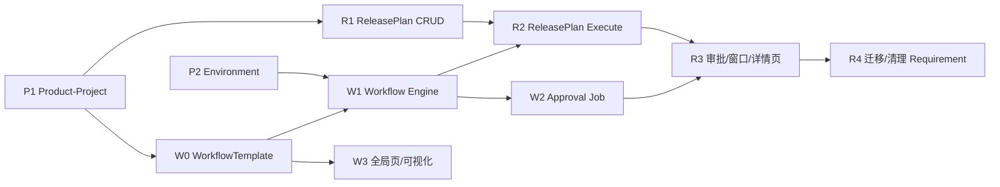

# SparkOps Product v2 开发方案

> 依据：[product_desgin.md](./product_desgin.md) · 参考实现：[plugins/zadig](../plugins/zadig)  
> 状态：**进入开发** · 版本：v1.0 · 2026-09-15

---

## 1. 目标与原则

### 1.1 交付目标（6–8 周内可演示）

| 目标 | 验收标准 |
|------|----------|
| **产品容器** | 创建 Product，将多个 Project 可选归属；独立 Project 不受影响 |
| **发布计划** | Product 下创建 ReleasePlan → 规划 → 审批 → 执行 text/workflow Job |
| **产品工作流** | 从模板挂载 ProductWorkflow，串行执行 build → deploy |
| **环境部署** | 产品内 Project 通过 Environment 部署（uat/prod） |

### 1.2 开发原则

1. **Project 独立优先**：任何迭代不得破坏 `product_id = NULL` 的独立项目路径
2. **API 向后兼容**：`/projects/*`、`/requirements/*` 保留至 R5 清理期
3. **垂直切片**：每个 Milestone 交付可演示的端到端能力，避免「只写后端」
4. **对标源码**：Workflow / ReleasePlan 行为以 `plugins/zadig` 为参考，SparkOps 差异见设计文档附录 B
5. **Feature Flag**：新能力默认按 Workspace 或配置开关灰度

---

## 2. 现状基线（As-Is）

### 2.1 已有能力

| 层 | 现状 | 路径 |
|----|------|------|
| DB | `product.products` / `product_plans` / `product_requirements` | `migrations/000012_product.up.sql` |
| 后端 | Product CRUD、Plan、Requirement approve/reject/release | `backend/internal/modules/product/` |
| 构建触发 | `ReleaseRequirementHandler` → Jenkins Build | `requirement_workflow.go` |
| Build 回调 | `on_build_completed` 更新 Requirement 状态 | `subscriber/on_build_completed.go` |
| 前端 | `/publish/products`、`/publish/plans`、`/publish/releases` 三页 | `fronted/.../product/components/` |
| Project Workflow | 单项目 Workflow CRUD + mock executor | `backend/internal/modules/workflow/` |

### 2.2 缺失能力（To-Build）

| 能力 | 设计文档章节 |
|------|-------------|
| `projects.product_id` 可选归属 | §7 Phase 1 |
| Product 详情页（Tab：概览/项目/环境/工作流/发布） | §5.2 |
| Environment 实体 | §7 Phase 2 |
| ReleasePlan + ReleasePlanJob | Part 2 §13–§22 |
| WorkflowTemplate + ProductWorkflow + Run 引擎 | Part 3 §23–§31 |
| 全局工作流页 `/workflows` | §29 |
| Requirement → ReleasePlan 迁移 | §17.1 |

### 2.3 技术栈约束

- **后端**：Go + Gin + GORM + PostgreSQL migration（`backend/migrations/0000xx_*.sql`）
- **前端**：Next.js App Router + BFF（`fronted/apps/web/app/api/bff/`）+ contracts（`fronted/packages/contracts/`）
- **执行**：复用现有 `BuildTrigger`、`DeploymentRun` 模块，不引入 MongoDB

---

## 3. 目标架构

### 3.1 模块划分

```
backend/internal/modules/
├── product/                    # 扩展：ReleasePlan、Environment（或独立 environment 子包）
│   ├── domain/model/
│   │   ├── release_plan.go
│   │   ├── release_plan_job.go
│   │   ├── environment.go
│   │   └── workflow/           # ProductWorkflow 领域（或独立 product_workflow 模块）
│   ├── application/
│   │   ├── command/
│   │   ├── query/
│   │   └── subscriber/         # build/deploy completed → 更新 JobRun
│   └── interface/http/
├── product_workflow/           # 建议独立模块，避免与 project workflow 混淆
│   ├── domain/engine/          # 阶段调度 + Job Executor
│   ├── infrastructure/executor/
│   │   ├── build_executor.go
│   │   ├── deploy_executor.go
│   │   └── approval_executor.go
│   └── ...
└── workflow/                   # 保留：Project 级轻量 Workflow（不动）
```

### 3.2 前端模块

```
fronted/apps/web/
├── app/(platform)/
│   ├── products/                    # 新增主入口
│   │   ├── page.tsx                 # 产品列表
│   │   └── [productId]/
│   │       ├── page.tsx             # 详情 Tab 容器
│   │       ├── release-plans/...
│   │       └── workflows/...
│   └── workflows/page.tsx           # 全局工作流（W3）
├── src/modules/product/
│   ├── components/                  # 已有 Panel 迁移/扩展
│   ├── release-plan/                # 新增
│   └── workflow/                    # 新增（Product 级）
└── packages/contracts/src/
    ├── product/release-plan.ts      # 新增
    └── product/workflow.ts          # 新增
```

### 3.3 依赖关系



**关键路径**：`P1 → W0 → W1（build）→ P2 → W1（deploy）→ R1 → R2`

---

## 4. Milestone 路线图

| Milestone | 周期 | 范围 | 演示场景 |
|-----------|------|------|----------|
| **M0** 准备 | 3 天 | 脚手架、contracts、migration 编号、feature flag | — |
| **M1** P1 | 2 周 | Product ↔ Project 关联 + `/products` 基础页 | 创建产品，加入 2 个项目，独立项目不受影响 |
| **M2** W0 | 1.5 周 | WorkflowTemplate + KeyVals + 2 个系统模板 seed | 浏览模板库，预览 YAML |
| **M3** R1 | 2 周 | ReleasePlan CRUD + 状态机（planning→executing→success） | 创建发布计划，添加 text Job |
| **M4** W1a | 2 周 | ProductWorkflow + `sparkops-build` 执行器 | 工作流并行构建 2 个 Project |
| **M5** P2 | 2 周 | Environment CRUD + deployment `environment_id` | uat 环境部署矩阵 |
| **M6** W1b+W2 | 2 周 | `sparkops-deploy` + `sparkops-approval` + Run 回调 | 构建→部署 UAT→审批→部署 prod |
| **M7** R2+R3 | 2 周 | ReleasePlan 执行 workflow Job、审批、发布窗口 | 完整发布计划端到端 |
| **M8** W3+R4 | 2 周 | `/workflows` 全局页、模板挂载 UI、ReleasePlan 详情 Tab | 对标 Zadig releaseWorkflow / releasePlan 详情 |
| **M9** 收尾 | 1 周 | Requirement 兼容层、文档、E2E | 旧 API 仍可用，新 UI 为主 |

**合计**：约 **16–18 周**（可按 2 后端 + 1 前端并行压缩至 10–12 周）

---

## 5. 分 Milestone 任务清单

### M0：准备（3 天）

| # | 任务 | 产出 |
|---|------|------|
| 0.1 | 确定 migration 起始号 `000045_*` | 空 migration 模板 |
| 0.2 | 新增 `contracts`：`ReleasePlanVM`、`ProductWorkflowVM`、`WorkflowTemplateVM` | TS + Zod schema |
| 0.3 | Feature flag：`product_v2_enabled`（config 或 env） | 后端 middleware |
| 0.4 | 创建 `product_workflow` 模块空壳 + wire 注册 | 编译通过 |
| 0.5 | 编写本方案链接至 `product_desgin.md` 顶部 | 文档交叉引用 |

---

### M1：P1 Product ↔ Project（2 周）

#### 数据库

```sql
-- 000045_product_v2_foundation.up.sql
ALTER TABLE product.products
  ADD COLUMN IF NOT EXISTS product_type VARCHAR(32) DEFAULT 'k8s_yaml',
  ADD COLUMN IF NOT EXISTS global_variables JSONB DEFAULT '{}',
  ADD COLUMN IF NOT EXISTS status VARCHAR(16) DEFAULT 'active';

ALTER TABLE workspace_app.projects
  ADD COLUMN IF NOT EXISTS product_id UUID NULL REFERENCES product.products(id);
CREATE INDEX IF NOT EXISTS idx_projects_product_id ON workspace_app.projects(product_id);
```

#### 后端

| 任务 | 文件 |
|------|------|
| Project 模型增加 `ProductID *kernel.ProductID` | `workspace_app/domain/model/project.go` |
| PatchProject 支持 set/clear `product_id` | `workspace_app/application/command/` |
| `GET /products/:id/projects` | `product/interface/http/handler.go` |
| `GET /products/:id/overview`（项目数、最近发布） | `product/application/query/` |
| 校验：移出 Product 时不清空构建/部署历史 | domain 规则 |

#### 前端

| 任务 | 路径 |
|------|------|
| 产品列表页 `/products` | `app/(platform)/products/page.tsx` |
| 产品详情 Tab 骨架（概览/项目/发布） | `app/(platform)/products/[productId]/page.tsx` |
| Project 创建/编辑：所属产品可选 | 现有 Project 表单扩展 |
| `/projects` 列表增加「所属产品」列 + 筛选 | `ProjectPanel` |

#### 验收

- [ ] 不创建 Product，独立 Project 构建部署与现网一致
- [ ] 创建 Product，2 个 Project 加入/移出
- [ ] API：`PATCH /projects/:id` body `{ "product_id": null }` 恢复独立

---

### M2：W0 WorkflowTemplate（1.5 周）

#### 数据库

```sql
-- 000046_workflow_templates.up.sql
CREATE TABLE product.workflow_templates (...);          -- 见 product_desgin.md §30.3
CREATE TABLE product.workflow_template_versions (...);
```

#### 后端

| 任务 | 说明 |
|------|------|
| `WorkflowTemplate` domain + repo | `KeyVals`、`Stages` JSONB |
| `GET/POST /workspaces/:wsId/workflow-templates` | 列表 + 创建 |
| Seed 2 个系统模板 | `std-build-deploy-uat`、`std-release-prod` |
| KeyVal 解析器（单元测试） | 输入 key_vals → 输出 resolved stages |

#### 前端

| 任务 | 说明 |
|------|------|
| 模板列表（产品详情 → 工作流 Tab → 从模板创建入口） | 只读预览 |
| YAML 预览组件 | 复用 WorkflowDetailPanel 样式 |

#### 验收

- [ ] 系统模板 API 返回 2 条，`key_vals` 结构正确
- [ ] 填写 KeyVals 后预览 resolved YAML

---

### M3：R1 ReleasePlan CRUD（2 周）

#### 数据库

```sql
-- 000047_release_plans.up.sql
CREATE TABLE product.release_plans (...);
CREATE TABLE product.release_plan_jobs (...);
CREATE TABLE product.release_plan_audit_logs (...);
```

#### 后端

| 任务 | 说明 |
|------|------|
| `ReleasePlan` / `ReleasePlanJob` 模型 + 状态机 | 见 §14.3，`planning`/`wait_for_approval`/`executing`/`success` |
| CRUD + `finish_planning` / `approve` / `reject` / `cancel` | command handlers |
| text Job：`done` / `skip` API | 人工 checklist |
| **暂不实现** workflow Job 执行 | M7 对接 |

#### 前端

| 任务 | 路径 |
|------|------|
| `/products/:id/release-plans` 列表 | 替代 `/publish/releases` 产品维度 |
| 发布计划详情页骨架（Tab：发布项/基本信息） | planning 态可编辑 Job |
| text Job 卡片 UI | §18 线框 |

#### 验收

- [ ] 创建 ReleasePlan → 添加 2 个 text Job → finish_planning → approve → 勾选完成 → success
- [ ] 审计日志记录 create/edit/approve

---

### M4：W1a ProductWorkflow + Build（2 周）

#### 数据库

```sql
-- 000048_product_workflows.up.sql
CREATE TABLE product.product_workflows (...);
CREATE TABLE product.product_workflow_runs (...);
ALTER TABLE product.products ADD COLUMN default_workflow_id UUID;
```

#### 后端

| 任务 | 说明 |
|------|------|
| `POST /products/:id/workflows/from-template` | KeyVals → Fork detached ProductWorkflow |
| `POST /products/:id/workflows/:id/runs` | 启动 Run |
| **Engine**：阶段串行、阶段内 parallel | `product_workflow/domain/engine/scheduler.go` |
| **Executor**：`sparkops-build` | 调用 `BuildTrigger.TriggerAutomated` |
| **Subscriber**：`on_build_completed` 扩展 | 反查 `workflow_run` job_run → 更新状态 → 调度下一 Job |

#### 前端

| 任务 | 说明 |
|------|------|
| 产品工作流 Tab：列表 + 从模板创建 | M2 挂载 UI |
| Run 详情：阶段树 + build 日志链接 | |

#### 验收

- [ ] 模板挂载 → 并行 build 2 Project → Run success
- [ ] Build 失败 → JobRun failed → Run failed

---

### M5：P2 Environment（2 周）

#### 数据库

```sql
-- 000049_environments.up.sql
CREATE TABLE product.environments (...);
CREATE TABLE product.environment_projects (...);
ALTER TABLE delivery.deployment_runs ADD COLUMN environment_id UUID NULL;
```

#### 后端

| 任务 | 说明 |
|------|------|
| Environment CRUD | cluster_id + namespace + 变量 |
| `GET /products/:id/environments/:envId/status` | Project × 部署版本矩阵 |
| Deployment 创建支持 `environment_id` | 解析 cluster/namespace |

#### 前端

| 任务 | 说明 |
|------|------|
| 产品详情 → 环境 Tab | dev/uat/prod CRUD |
| 产品概览部署矩阵 | |

#### 验收

- [ ] 产品内 Project 部署到 uat Environment
- [ ] 独立 Project 仍选集群直部署

---

### M6：W1b Deploy + W2 Approval（2 周）

#### 后端

| 任务 | 说明 |
|------|------|
| **Executor**：`sparkops-deploy` | `source=fromjob` 注入 IMAGE；`environment_id` |
| **Executor**：`sparkops-approval` | 站内 approve/reject；timeout |
| **Subscriber**：`on_deployment_completed` | 更新 deploy JobRun |
| `error_policy`：`stop` / `ignore_error` | 先实现 stop |

#### 前端

| 任务 | 说明 |
|------|------|
| Run 详情：deploy 子状态 | |
| 审批弹窗 / 待办入口 | |

#### 验收

- [ ] 标准生产发布模板：build → deploy uat → approval → deploy prod 全流程

---

### M7：R2+R3 ReleasePlan 执行整合（2 周）

#### 后端

| 任务 | 说明 |
|------|------|
| workflow Job：`mode=reference` → 创建 ProductWorkflowRun | 对标 `WorkflowReleaseJobSpec` |
| ReleasePlan `execute`：串行调度 Job | text → workflow → text |
| 发布窗口校验 `start_time`/`end_time` | |
| `schedule_execute_time` 定时（复用 cron 模块或内部 scheduler） | Phase R3 |
| Requirement API 适配层 | 内部转 ReleasePlan 单 Job |

#### 前端

| 任务 | 说明 |
|------|------|
| 发布计划详情：executing 态 Job 操作 | 执行/跳过/重试 |
| Tab：审批、操作记录 | |
| Project 工作台：有 active ReleasePlan 时提示 | |

#### 验收

- [ ] ReleasePlan workflow Job 触发 ProductWorkflow Run 并完成
- [ ] 旧 `/requirements` 创建仍可用（适配层）

---

### M8：W3 全局工作流 + 体验（2 周）

| 任务 | 说明 |
|------|------|
| `GET /workspaces/:wsId/workflows` 跨 Product 列表 | 对标 `releaseWorkflow` |
| `/workflows` 页面 | 搜索、筛选、一键执行 |
| 工作流 YAML 编辑（Monaco） | 与可视化 Tab 切换（可视化可 Phase 2） |
| Workspace 自定义模板 CRUD | |
| ReleasePlan 详情 UI  polish | 对标 course.koderover.com 规划态 |

---

### M9：收尾（1 周）

| 任务 | 说明 |
|------|------|
| `product_requirements` → `release_plans` 数据迁移脚本 | §17.1 |
| 废弃标记：`ProductRequirement` API deprecated header | |
| E2E：产品创建 → 模板工作流 → 发布计划执行 | Playwright 或 API 集成测试 |
| 更新 README / 运维文档 | |

---

## 6. API 增量清单（按优先级）

### P0（M1–M3）

```
PATCH  /projects/:projectId                         # +product_id
GET    /products/:productId/projects
GET    /products/:productId/overview
GET    /workspaces/:wsId/workflow-templates
GET    /workspaces/:wsId/workflow-templates/:id
GET    /products/:productId/release-plans
POST   /products/:productId/release-plans
GET    /products/:productId/release-plans/:id
POST   /products/:productId/release-plans/:id/finish-planning
POST   /products/:productId/release-plans/:id/approve
POST   /products/:productId/release-plans/:id/jobs/:jobId/skip
```

### P1（M4–M7）

```
POST   /products/:productId/workflows/from-template
POST   /products/:productId/workflows/:id/runs
GET    /products/:productId/workflows/:id/runs/:runId
POST   /products/:productId/release-plans/:id/execute
GET    /products/:productId/environments
POST   /products/:productId/environments
GET    /workspaces/:wsId/workflows                          # 全局
```

---

## 7. 测试策略

| 层级 | 范围 | 工具 |
|------|------|------|
| 单元 | 状态机转换、KeyVal 解析、JSON Patch、Job 调度顺序 | Go `testing` |
| 集成 | Repo + 真实 PostgreSQL（testcontainer 或 dev DB） | Go integration |
| 契约 | contracts schema ↔ 后端响应 | TS 类型检查 + 抽样 API test |
| E2E | M7 后：发布计划全链路 | 手动 / Playwright |

**每个 Milestone 必须**：至少 1 个集成测试覆盖 happy path + 1 个状态非法转换测试。

---

## 8. 风险与对策

| 风险 | 影响 | 对策 |
|------|------|------|
| Build/Deploy 回调找不到 Run | Job 卡 running | `execution_ref` 双向索引；超时 watchdog |
| Environment 与现网 Deployment 冲突 | 部署路径分裂 | `environment_id` nullable；独立 Project 不走 Environment |
| Workflow 与 Project Workflow 命名混淆 | 开发/运维混乱 | 模块分 `product_workflow`；UI 称「产品工作流」 |
| 范围膨胀（Zadig 40+ Job） | 延期 | 严格 W1 仅 build+deploy；其余进 backlog |
| Requirement 迁移丢数据 | 生产事故 | 双写期；迁移脚本可回滚 |

---

## 9. 团队分工建议

| 角色 | M1–M3 | M4–M7 | M8+ |
|------|-------|-------|-----|
| **后端 A** | P1 + R1 domain | Workflow engine + executors | 全局 API |
| **后端 B** | Template + migration | Environment + deploy 整合 | 迁移脚本 |
| **前端** | /products 页 + ReleasePlan 列表/详情 | Workflow Run UI + 环境 Tab | /workflows 全局页 |
| **QA** | 独立 Project 回归 | 发布计划 E2E | 兼容层验证 |

---

## 10. 第一个 Sprint 行动项（本周可启动）

> **Sprint 1 = M0 + M1 前半（5 个工作日）**

| 天 | 后端 | 前端 |
|----|------|------|
| D1 | `000045` migration；Project `product_id` 字段 | contracts：`ProductOverviewVM` |
| D2 | PatchProject + 校验逻辑 | `/products` 列表页（复用 ProductsPanel） |
| D3 | `GET /products/:id/projects` | 产品详情 Tab 路由骨架 |
| D4 | `GET /products/:id/overview` | Project 表单「所属产品」下拉 |
| D5 | 集成测试 + `/projects` 列表筛选 | 联调 + 独立 Project 回归 |

**Sprint 1 完成定义**：演示「创建 Product → 关联 2 个 Project → 概览页显示项目数」。

---

## 11. 与设计文档的索引

| 开发 Milestone | 设计文档 |
|----------------|----------|
| M1 | Part 1 §7 Phase 1、§5 UI、§8 API |
| M2–M4、M6、M8 | Part 3 §23–§31、附录 B |
| M3、M7 | Part 2 §13–§22 |
| M5 | Part 1 §7 Phase 2、§6.2 |
| M9 | §10 迁移、§17 数据迁移 |

---

## 12. Backlog（明确不做进 v2 首期）

- ReleasePlan WebSocket 协同编辑
- External check hooks（13+ 态完整版）
- Application 目录、Sprint Management
- 可视化工作流拖拽编辑器（W3 仅 YAML + 列表）
- Helm 灰度 / Istio / MSE 发布策略 Job
- linked 模板 JSON Patch 自动合并 UI
