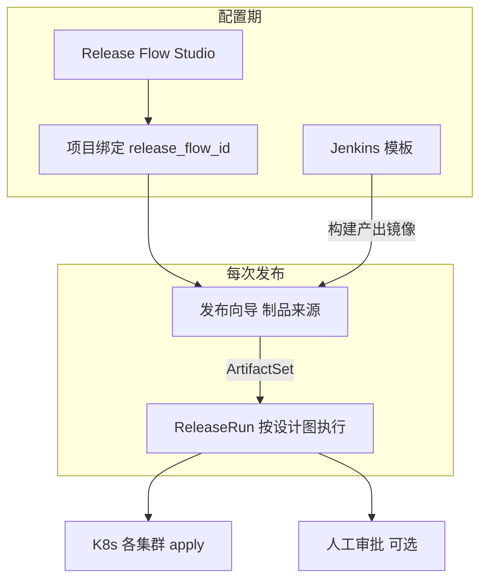

# 发布流程设计图（Release Flow）设计

> 版本：v1.0 · 2026-09-03  
> 状态：已评审（产品决策已确认）  
> 父文档：`spec/delivery-center-design.md`  
> 相关：`docs/superpowers/specs/2026-09-03-release-orchestration-handoff-design.md`  
> 范围：将「发布到多 K8s 集群」抽象为 Workspace 级可复用线性设计图；项目绑定后每次发布按图执行

---

## 1. 目标

用户希望发布不再是每次在向导里拼装 Pipeline / Fleet，而是：

1. 在 Workspace 中绘制一张 **发布流程设计图**（Release Flow）
2. 设计图节点 = **具体 K8s 集群**（写死，非占位）
3. 节点之间 **只允许一条线性链**（无分叉、无并行）
4. 每个节点可配置 **人工审核模式**：不审核 / 部署前审 / 部署后审
5. **项目绑定一张设计图**；之后每次发布只选制品来源，按绑定流程自动执行

构建仍归 Jenkins 模板；设计图只回答「怎么发布」。中间交接 **ArtifactSet** `{ image_repository, image_tag }`。

## 2. 已确认决策

| 决策 | 选择 |
|------|------|
| 集群绑定方式 | **写死** Workspace 内已授权的具体集群 |
| 拓扑 | **只允许一条链**（线性顺序） |
| 审核 | **每节点自选**：`none` / `before_deploy` / `after_deploy` |
| 实现路径 | 新增 **`ReleaseFlow` 实体** + Studio；底层编译为 Pipeline DAG 执行 |
| 构建 | 不替换 Jenkins 模板 / Jenkinsfile |
| 项目字段 | `release_flow_id`（发布）与 `jenkinsfile_template_id`（构建）分开 |
| 向导 | 绑定设计图后 **不再选 Pipeline/Fleet**；只选制品 + 确认 |
| 兼容 | 保留经典 `POST .../deployments` 单集群路径 |

## 3. 非目标

- 并行分叉、汇合、Canary / 蓝绿
- 向导内临时修改集群链
- 占位集群 / 项目级集群映射
- 替换 Jenkins 构建或 Pipeline Studio 通用 DAG 能力（一期可隐藏高级入口）
- 第一期 image digest 锁定（沿用 `repo + tag`）
- 完整后端 Run Engine（可先 Mock 节点推进 + 真构建 API）

---

## 4. 核心模型

### 4.1 两个世界，一条交接

```
Jenkins 模板  →  怎么构建（不变）
ReleaseFlow   →  怎么发布（新：设计图）
ArtifactSet   →  构建与发布之间的制品
```

项目绑定：

```
project.jenkinsfile_template_id   // 构建（已有）
project.release_flow_id           // 发布设计图（新增，发布后必填）
```

### 4.2 ReleaseFlow

**Workspace 级、可版本化、可被多项目复用。**

- 一条 **线性链**：节点 0 → 节点 1 → … → 节点 N-1
- 每个节点对应一个 **具体 cluster_id**
- 顺序即发布顺序：前一节点完全完成（含该节点配置的审核）后，才进入下一节点

**节点字段：**

| 字段 | 说明 |
|------|------|
| `cluster_id` | Workspace 已授权的 K8s 集群 |
| `approval` | `none` / `before_deploy` / `after_deploy` |
| `profile_id` | 可选，该集群使用的 Environment Profile |
| `display_name` | 节点显示名（如 staging-cn、prod） |

**链约束：**

- 单路径、无环、无分叉
- 同一集群在同一 Flow 中不可重复出现
- 保存时校验：所有 cluster 已授权且 Ready（Blocked 可警告但不阻止保存 draft）

### 4.3 审核模式语义

| 模式 | 执行顺序 |
|------|----------|
| `none` | `k8s.deploy` → `k8s.wait_rollout` → 下一节点 |
| `before_deploy` | `approval.manual` → `k8s.deploy` → `k8s.wait_rollout` → 下一节点 |
| `after_deploy` | `k8s.deploy` → `k8s.wait_rollout` → `approval.manual` → 下一节点 |

审批复用现有 `workflow` / `approval.manual`；设计器只暴露三态开关，不暴露 workflow 细节。

### 4.4 与 Pipeline 的关系

ReleaseFlow 是 **面向业务的发布设计图**；执行层 **自动编译** 为 release-only Pipeline DAG（对用户透明）：

```
节点 i（cluster C, approval=A）展开：

  A = none:
    deploy-{i}:  k8s.deploy(cluster=C) → k8s.wait_rollout

  A = before_deploy:
    approve-{i}: approval.manual(title="发布到 {display_name}")
    deploy-{i}:  needs [approve-{i}] → k8s.deploy → wait_rollout

  A = after_deploy:
    deploy-{i}:  k8s.deploy → wait_rollout
    approve-{i}: needs [deploy-{i}] → approval.manual
```

链上顺序：`deploy/approve` 的最后一 stage of 节点 i-1 → 节点 i 的第一 stage，通过 `needs` 串联。

ReleaseRun 创建时锁定 `release_flow_id + flow_version`；运行中改 Flow 不影响已在跑的 Run。

---

## 5. UI 设计

### 5.1 Release Flow Studio

**入口：** Delivery → **发布流程**（新菜单，与 Pipeline Studio 并列）

**画布：** 横向线性链（React Flow，编辑器限制单链）

| 操作 | 行为 |
|------|------|
| 左侧拖入集群 | 节点 = 已授权 K8s 集群（名称 + 环境标签） |
| 连线 | 仅允许「前 → 后」；自动校验单链 |
| 选中节点 | 属性：审核模式、Profile（可选）、显示名 |
| 保存 | `ReleaseFlow` version +1；`draft → active` |

**预置模板：**

- `dev → staging → prod`（staging 不审，prod 部署前审）
- `staging → prod`（prod 部署后审）

**与 Pipeline Studio 分工：**

| 表面 | 职责 |
|------|------|
| Release Flow Studio | 画「发到哪些集群、顺序、要不要人审」 |
| Pipeline Studio | 高级通用 DAG（验证、通知等）；一期可只读或隐藏 |

### 5.2 项目绑定

**位置：** 项目配置向导 / 项目设置

- 下拉选择 Workspace 内 `status=active` 的 ReleaseFlow
- 只读预览：集群链 + 各节点审核模式
- 未绑定 `release_flow_id` 时，「发布」禁用，提示「请先绑定发布流程」

### 5.3 发布向导（简化）

绑定设计图后：

```
Step 1  制品来源
        ├─ 使用已有镜像
        └─ 先构建再发布（Git ref → Jenkins）

Step 2  确认（只读展示绑定的设计图）
        集群链 + 审核模式 + 制品坐标

Step 3  执行观测 → Release Run / Fleet Board
```

用户 **不可** 在向导中临时改链；改流程须编辑 ReleaseFlow 或更换项目绑定。

**确认页摘要示例：**

```
制品: harbor.local/test-project/app:1.4.2
流程: dev → staging(部署后审) → prod(部署前审)
```

### 5.4 Run 观测

Release Run 详情 / Fleet Board **按设计图节点** 展示状态：

`pending` | `waiting_approval` | `deploying` | `succeeded` | `failed`

不默认向业务用户展示编译后的 Pipeline YAML。

---

## 6. 数据模型（`cd` schema）

### 6.1 release_flows

| 字段 | 类型 | 说明 |
|------|------|------|
| id | uuid PK | |
| workspace_id | uuid FK | |
| name | text | |
| description | text | |
| status | enum | draft / active / archived |
| version | int | 每次保存 +1 |
| compiled_pipeline_id | uuid | 可选，编译缓存 |
| layout | jsonb | 画布坐标 |
| created_at, updated_at | timestamptz | |

### 6.2 release_flow_nodes

| 字段 | 类型 | 说明 |
|------|------|------|
| id | uuid PK | |
| flow_id | uuid FK | |
| flow_version | int | 与 release_flows.version 对齐 |
| sort_order | int | 链上位置 0..N-1 |
| cluster_id | uuid FK | → cluster_info |
| approval | enum | none / before_deploy / after_deploy |
| profile_id | uuid | 可选 |
| display_name | text | |

唯一约束：`(flow_id, flow_version, sort_order)`；`(flow_id, flow_version, cluster_id)` 不重复。

### 6.3 projects（workspace_app 增量）

```sql
ALTER TABLE workspace_app.projects ADD COLUMN release_flow_id uuid;
```

### 6.4 release_runs

可独立表或 `pipeline_runs` + `run_type = release_flow`：

| 字段 | 说明 |
|------|------|
| id | Run ID |
| project_id | |
| release_flow_id, flow_version | 锁定版本 |
| artifact_repository, artifact_tag | ArtifactSet |
| git_ref_type, git_ref_value | 先构建时有值 |
| source | artifact / build |
| current_node_index | 当前链上节点 |
| node_states | jsonb：每节点 status、approval_run_id、task_run_id |
| status | queued / running / paused / succeeded / failed / cancelled |
| created_by, created_at | |

### 6.5 与 DeploymentRun 兼容

经典 `POST .../deployments` 等价于：

- 1 节点 ReleaseFlow（单 cluster、approval=none）
- 或 legacy 路径直接写 deployment_runs，`release_id` 可空

---

## 7. API（最小集）

```
GET/POST   /workspaces/:ws/release-flows
GET/PUT    /workspaces/:ws/release-flows/:id
POST       /workspaces/:ws/release-flows/:id/publish-version    # draft → active

GET        /projects/:id/release-flow                          # 绑定 + 只读预览
PUT        /projects/:id/release-flow                          # 设置 release_flow_id

GET        /projects/:id/artifacts                             # 最近成功 tag（已有规划）
POST       /projects/:id/releases                              # source + 自动带绑定的 flow
GET        /delivery/runs/:runId                              # 按设计图节点展示
POST       /delivery/runs/:runId/nodes/:nodeId/approve        # 人工审批通过/拒绝
```

`POST /projects/:id/releases` 请求体（示意）：

```json
{
  "source": "artifact",
  "image_tag": "1.4.2",
  "git_ref_type": "branch",
  "git_ref_value": "master"
}
```

服务端从项目读取 `release_flow_id`，锁定当前 active version，创建 ReleaseRun。

---

## 8. 执行流程

### 8.1 每次发布

```
来源 = 已有镜像:
  artifact.ready → 按 ReleaseFlow 节点 0..N 顺序执行

来源 = 先构建:
  Jenkins build → artifact.ready → 按 ReleaseFlow 节点 0..N 顺序执行
```

### 8.2 单节点状态机

```
none:
  deploying → succeeded | failed

before_deploy:
  waiting_approval → deploying → succeeded | failed

after_deploy:
  deploying → waiting_approval → succeeded | failed
```

节点 failed 时，默认 **停止整条链**（一期不做 skip/onFailure）。

### 8.3 K8s apply

每节点 deploy 调用现有 `YAMLManifestRenderer` + `ManifestDeployer`：

- 镜像强制为 ArtifactSet 的 `{repository}:{tag}`
- 凭证第一期仍用项目级 `kubernetes_secret_id`
- Profile 参与渲染（若节点配置了 profile_id）

---

## 9. 架构总览



编译层（透明）：

```
ReleaseFlow ──compile──▶ Pipeline DAG ──▶ Run Engine / Step Executors
```

---

## 10. 落地顺序

1. **Release Flow 前端 Mock**：Studio 线性链编辑器 + 项目绑定 + 简化发布向导 + Run 按节点 Mock 推进
2. **编译器**：ReleaseFlow → Pipeline stages（单元测试覆盖三态审核）
3. **后端表 + API**：release_flows / nodes / releases CRUD
4. **Run 执行**：接真 K8s deploy + workflow 审批
5. **观测**：Fleet Board / Run 详情按设计图节点渲染
6. digest lock、per-cluster 凭证、Policy 门禁

---

## 11. 验收标准

- Workspace 可创建并激活一条 `dev → staging → prod` 线性 ReleaseFlow，节点含三种审核模式
- 两个项目可绑定同一张 Flow；改 Flow 新版本不影响已存在 Run
- 项目未绑定 Flow 时无法发布
- 绑定后发布向导只有「制品来源 + 确认」；确认页展示完整集群链与审核模式
- 选「已有镜像」不触发 Jenkins；选「先构建」触发 Jenkins 后按链发布
- prod 节点 `before_deploy` 时，未审批不会 apply 到 prod
- staging 节点 `after_deploy` 时，apply 成功后才出现审批卡点
- 经典单集群部署行为与现网一致
- Run 详情按 **设计图节点** 展示进度，而非原始 Pipeline YAML

---

## 12. 与既有文档关系

| 文档 | 关系 |
|------|------|
| `delivery-center-design.md` | 父架构；ReleaseFlow 是 Pipeline/Fleet 面向业务的简化产品层 |
| `2026-09-03-release-orchestration-handoff-design.md` | 制品来源与 Jenkins 交接仍有效；向导 Step 2 起由本文替代 Pipeline/Fleet 选择 |
| `2026-09-03-pipeline-studio-dag-design.md` | Studio 技术可复用；Release Flow Studio 为受限线性模式 |

---

*构建归 Jenkins；发布归 Release Flow 设计图；项目只绑定一张图，每次发布按图走。*
