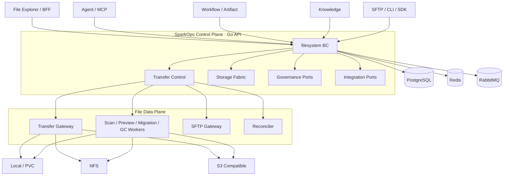
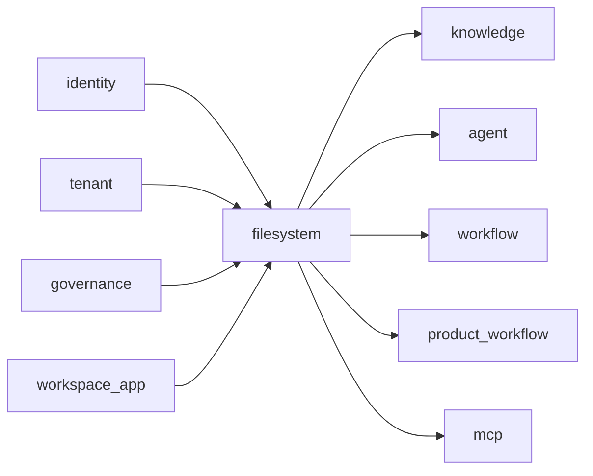

# SparkOps 企业级统一文件基础设施设计

| 项目 | 内容 |
|---|---|
| 状态 | 已确认 |
| 日期 | 2026-11-12 |
| 目标版本 | Unified File Infrastructure v1.0 |
| 部署形态 | 企业私有化，单客户多组织 |
| 基准容量 | 单文件 ≤ 20 GB；总数据量 ≤ 100 TB；并发传输 ≤ 200 |
| 可用性目标 | 99.9%；RPO ≤ 15 分钟；RTO ≤ 2 小时 |
| 首发存储 | Local/PVC、NFS、S3 Compatible |
| 关联初稿 | [filesystem_desigin.md](../../filesystem_desigin.md) |
| 现有架构 | [SparkOps技术架构说明.md](../../SparkOps技术架构说明.md) |

## 1. 摘要

SparkOps 将新增企业级统一文件基础设施，为 Human、Agent、Workflow、Knowledge、Project 和外部集成提供同一套文件资源、权限、传输、存储编排、审计与生命周期能力。

本设计保留初稿中正确的核心思想：

- Namespace、File Revision、Blob、Storage Replica 分层。
- Control Plane、Data Plane、Governance Plane 职责分离。
- Transfer Session、配额预占、校验与提交状态机。
- Storage Pool、Placement Policy、跨存储迁移和生命周期。
- Transactional Outbox、幂等补偿、对账和延迟垃圾回收。
- Agent 使用最小权限 Capability Token，不继承用户全部权限。

本设计同时根据 SparkOps 现状修正以下方向：

- 不另建一套微服务平台和第二套 IAM。
- 控制面作为 `filesystem` 限界上下文接入现有 Go 模块化单体。
- 复用现有 Organization、Workspace、governance、Casbin/OPA、Entitlement、审计和 RabbitMQ Outbox。
- 大文件传输、SFTP、扫描、预览、迁移和 GC 作为同仓可独立部署的数据面进程。
- 前端遵循现有 `contracts → upstream → bff-modules → BFF Route → web-sdk → UI` 链路。
- Knowledge、Agent、Workflow 等业务域只保存 File ID 或 Artifact ID，不接触 bucket、object key 或宿主机路径。

最终采用“演进式混合架构”：一个产品、一个仓库、统一领域契约，控制面与数据面独立扩缩容。完整企业能力作为一个正式版本交付，内部设置五个不可跳过的验收门。

## 2. 目标与非目标

### 2.1 产品目标

1. 为组织、工作区、项目、用户、Agent 和 Workflow 提供统一文件命名空间。
2. 支持目录、上传、下载、断点续传、复制、移动、重命名、删除、回收站、版本和搜索。
3. 支持 Local/PVC、NFS、S3 Compatible，并可扩展腾讯 COS、阿里 OSS、Azure Blob。
4. 支持工作区默认存储、用户或项目绑定存储池、策略路由和跨存储迁移。
5. 支持浏览器、SDK、CLI、服务端导入、SFTP 和 MCP。
6. 支持配额、审计、共享、分类、保留、扫描、预览、归档和 GC。
7. 为 Knowledge、Agent、Workflow 提供文件引用、Artifact 和事件集成。
8. 将现有 `knowledge.documents.content` 一次性迁移到统一文件基础设施，并保留安全回滚能力。

### 2.2 首发后端范围

- Local/PVC。
- NFS。
- S3 Compatible。

腾讯 COS、阿里 OSS 和 Azure Blob 不作为首发原生验收项，但 Provider Contract 必须覆盖其能力差异，后续增加适配器时不得修改业务 API 或领域模型。

### 2.3 明确非目标

- 不实现完整 POSIX 内核、FUSE 文件系统或分布式块存储。
- 不替代 Ceph、JuiceFS、NFS、S3 等持久化产品。
- 不支持跨组织透明 Blob 去重。
- 不允许业务模块直连物理存储。
- 不用 PostgreSQL 与对象存储之间的分布式事务。
- 不把 Redis 作为配额、授权或文件元数据的事实源。
- 不在 v1.0 引入 Kafka、OpenFGA 或新的 Python 平台作为强制基础设施。
- 不承诺跨地域双活；本版本目标为同地域高可用。

## 3. 架构原则

### 3.1 单一治理源

身份、组织、工作区、角色和功能权限继续由现有 `identity`、`tenant`、`governance` 管理。文件域只维护资源关系、共享授权、分类和短期 Capability，不复制用户、角色或组织主数据。

### 3.2 元数据单写

只有 `filesystem` BC 可写文件元数据。Knowledge、Agent、Workflow、Product 等 BC 仅通过 Port 调用文件能力，并保存不可变 File ID 或 Artifact ID。

### 3.3 路径不是身份

逻辑路径用于人机交互，不用于跨模块引用。移动、重命名和挂载变化不得破坏业务引用。

### 3.4 控制流与字节流分离

权限决策、元数据、配额和状态机由控制面管理；大文件字节流尽量在 Browser/SDK 与 S3、或客户端与 Transfer Gateway 之间传输。

### 3.5 能力最小公分母

统一 API 只承诺所有 Provider 都可实现的语义。Provider 专有能力通过 Capability 描述，不泄漏到普通文件 API。

### 3.6 最终一致而非伪原子

数据库和存储之间使用状态机、Outbox、幂等、对账与补偿。任何失败都必须可重试、可诊断、可收敛。

### 3.7 默认拒绝与租户边界优先

跨组织访问默认拒绝。显式 Deny 优先于 Allow。任何缓存都不能绕过组织和工作区归属检查。

## 4. 总体架构



### 4.1 Control Plane

部署在现有 Go API 中，负责：

- Namespace、Node、Revision、Blob 和 Replica 元数据。
- Transfer Session、配额预占、提交和取消。
- Storage Provider、Pool、Binding、Placement Policy 和 Mount。
- 授权决策编排、Resource Grant、Capability 签发与撤销。
- 生命周期、迁移、复制、归档、回收站和 GC 任务定义。
- File Link、Artifact 和文件事件。
- 搜索元数据、审计查询和管理 API。

### 4.2 Data Plane

独立 Workload，负责：

- Local/NFS 上传下载流。
- S3 分片签名和完成校验。
- 限速、并发控制、Checksum 和流式加密。
- 敏感下载的网关强制代理。

数据面不解释角色。它只接受控制面签发的短期、受众绑定、范围明确的 Capability Token。

### 4.3 Async Plane

独立 Worker 与协议网关，负责：

- 恶意软件扫描和隔离。
- 文件预览、缩略图和格式转换。
- SFTP Landing Zone 导入。
- 跨存储复制、迁移和副本修复。
- 生命周期执行、孤儿对象清理和 Blob GC。
- 元数据与存储对账。

### 4.4 Governance Plane

逻辑上独立，物理上复用现有平台：

- `identity`：Human、Service Account、API Token。
- `tenant`：Organization、Workspace、成员和基础配额。
- `governance`：Workspace Role、功能权限码、Casbin、可选 OPA。
- `entitlements`：`filesystem` 模块开关。
- `audit` 与 `operationlog`：管理操作和访问审计。

## 5. SparkOps 模块边界

### 5.1 后端目录

```text
backend/
├── cmd/
│   ├── server/                    # 现有控制面
│   ├── file-transfer-gateway/     # 数据面
│   ├── file-worker/               # 扫描/预览/迁移/GC
│   ├── sftp-gateway/              # SFTP 协议入口
│   └── file-reconciler/           # 对账；租约单活
├── internal/
│   ├── modules/filesystem/
│   │   ├── interface/http/
│   │   ├── application/
│   │   ├── domain/
│   │   └── infrastructure/
│   └── platform/storage/
│       ├── provider.go
│       ├── capability.go
│       └── adapters/
└── migrations/
```

### 5.2 前端目录

```text
fronted/
├── apps/web/
│   ├── app/(platform)/files/
│   ├── app/api/bff/v1/workspaces/[wsId]/files/
│   └── src/modules/filesystem/
└── packages/
    ├── contracts/src/filesystem/
    ├── upstream/src/filesystem.ts
    ├── bff-modules/src/filesystem/
    └── web-sdk/src/filesystem.ts
```

### 5.3 跨 BC 依赖



箭头表示 Port、ACL 或事件协作，不表示跨 BC 直接导入 domain 或 infrastructure。

## 6. 领域模型

### 6.1 核心实体

| 实体 | 作用 | 关键字段 |
|---|---|---|
| `filesystem.namespaces` | 工作区逻辑文件空间 | `id`, `organization_id`, `workspace_id`, `root_node_id`, `status` |
| `filesystem.nodes` | 文件和目录节点 | `id`, `namespace_id`, `parent_id`, `node_type`, `name`, `normalized_name`, `current_revision_id`, `state` |
| `filesystem.file_revisions` | 不可变文件版本 | `id`, `node_id`, `revision_no`, `blob_id`, `size`, `mime_type`, `created_by` |
| `filesystem.blobs` | 内容身份 | `id`, `dedup_domain`, `sha256`, `size`, `encryption_key_ref`, `ref_count`, `state` |
| `filesystem.storage_replicas` | 物理副本 | `id`, `blob_id`, `provider_id`, `object_key`, `checksum`, `state`, `verified_at` |
| `filesystem.storage_providers` | 存储连接 | `id`, `type`, `endpoint`, `secret_ref`, `capabilities`, `health` |
| `filesystem.storage_pools` | 业务可绑定资源池 | `id`, `name`, `status`, `placement_policy_version` |
| `filesystem.storage_pool_members` | Pool 与 Provider 关系 | `pool_id`, `provider_id`, `priority`, `mode` |
| `filesystem.storage_bindings` | Scope 与 Pool 绑定 | `scope_type`, `scope_id`, `pool_id`, `priority` |
| `filesystem.mounts` | 逻辑挂载 | `namespace_id`, `mount_path`, `pool_id`, `access_mode` |

### 6.2 运行态与治理实体

| 实体 | 作用 |
|---|---|
| `filesystem.transfer_sessions` | 上传、导入和下载控制会话 |
| `filesystem.transfer_parts` | 分片 ETag、大小和校验和 |
| `filesystem.quota_accounts` | 字节、文件数的已用与预占事实 |
| `filesystem.quota_reservations` | 上传配额预占及过期释放 |
| `filesystem.resource_grants` | 目录/文件资源级共享和临时授权 |
| `filesystem.capabilities` | Capability 哈希、范围、受众、过期和撤销 |
| `filesystem.lifecycle_policies` | 保留、归档、删除和转换策略 |
| `filesystem.lifecycle_jobs` | 可恢复的迁移、复制、归档和 GC 任务 |
| `filesystem.file_links` | Knowledge、Agent Run、Workflow Artifact 等业务引用 |
| `filesystem.data_classifications` | Public、Internal、Confidential、Restricted |
| `filesystem.search_documents` | 可选的搜索投影状态，不作为主元数据 |

### 6.3 关键约束

1. 同一父目录内使用唯一键 `(namespace_id, parent_id, normalized_name)`。
2. Revision 创建后不可修改内容字段。
3. Node 的 `current_revision_id` 只能指向自身 Revision。
4. Blob 去重唯一键为 `(dedup_domain, sha256, size)`。
5. `dedup_domain` 默认按 Organization 隔离。
6. Replica 只有完成独立校验后才能进入 `AVAILABLE`。
7. 跨组织复制必须创建新 Node 和新的组织内 Blob 归属，不共享引用。
8. Blob 的物理删除必须同时满足无有效 Revision 引用、无保留策略阻止、超过回收宽限期。
9. 配额事实以 PostgreSQL 为准；Redis 只用于租约、热点计数和限流。
10. 所有长任务拥有幂等键、租约、checkpoint、重试次数和最后错误。

## 7. 资源生命周期

### 7.1 Node

```text
ACTIVE → TRASHED → RETENTION_HOLD → PURGE_PENDING → PURGED
   └──────────────────────────────→ ACTIVE
```

- 删除默认进入回收站。
- 恢复时若原名称冲突，必须由用户选择新名称，不静默覆盖。
- 法务保留或合规保留可阻止 Purge。

### 7.2 Blob

```text
PENDING → AVAILABLE → TOMBSTONED → GC_PENDING → DELETED
              └─────→ QUARANTINED
```

- `PENDING` Blob 不可被普通下载。
- 恶意文件进入 `QUARANTINED`，保留受限审计访问。
- 引用计数只是优化；GC 前必须以 Revision 和保留关系做最终查询确认。

### 7.3 Replica

```text
CREATING → VERIFYING → AVAILABLE → DRAINING → DELETED
    └───────────────→ FAILED
```

故障切换只能选择 `AVAILABLE` 且校验未过期的副本。

## 8. Storage Fabric

### 8.1 Provider Contract

Provider 必须声明能力，而非假装所有后端语义相同：

- `Put`, `Get`, `Delete`, `Stat`, `Copy`。
- Multipart：是否支持、最小分片、最大分片数。
- Conditional Write：If-Match、If-None-Match。
- Server-Side Copy。
- Range Read。
- Presigned Upload/Download。
- Native Versioning。
- Encryption、Object Lock、Lifecycle。
- POSIX Rename、Atomic Rename、File Lock。

领域层根据 Capability 选择算法。缺少原子 rename 时使用“复制 → 校验 → 引用切换 → 延迟删除”。

### 8.2 Storage Pool

业务绑定 Pool，不绑定 Provider。Pool 可包含一个或多个 Provider：

- `PRIMARY`：新写入目标。
- `REPLICA`：异步副本。
- `ARCHIVE`：低频或归档层。
- `DRAINING`：停止新写入，等待迁移。

### 8.3 Placement 决策顺序

1. Scope Binding：Organization、Workspace、Project、User。
2. Compliance：分类、地域、保留和加密要求。
3. Capability：文件大小、直传、POSIX 和对象锁要求。
4. Health：容量、错误率、延迟和熔断状态。
5. Explicit Fallback：显式默认 Pool。

Placement Policy 与 IAM Policy 独立版本化。每次决策将 `policy_version`、命中规则和目标 Pool 写入 Transfer Session。

### 8.4 Mount

- Virtual Mount 是所有后端的默认访问模式。
- POSIX Mount 只允许 Local/PVC 和 NFS。
- 对象存储不承诺文件锁、原子目录 rename 或完整 POSIX 权限。
- Spark、训练任务等 POSIX 场景通过独立 File Gateway 或已验证的外部文件网关处理。

## 9. 传输平台

### 9.1 统一入口

Browser、SDK、CLI、Server Import 和 SFTP 都必须创建 Transfer Session，不允许绕过授权、配额和提交协议。

### 9.2 上传状态机

```text
INITIATED
  → UPLOADING ⇄ PAUSED
  → VERIFYING
  → SCANNING
  → COMMITTING
  → COMPLETED

任意非终态 → FAILED / ABORTED
扫描拒绝   → REJECTED
```

终态不可回退。重试通过同一 Session 或显式 Retry Session 进行，不创建重复 Revision。

### 9.3 创建会话

控制面执行：

1. 认证、工作区成员和 `file:write` 检查。
2. 目录级授权和数据分类检查。
3. 使用 `Idempotency-Key` 去重。
4. Placement 决策。
5. 按声明大小预占配额。
6. 创建临时对象键和分片计划。
7. 签发短期 Capability 或预签名 URL。

### 9.4 数据上传

- S3：浏览器或 SDK 使用短期预签名 URL 分片直传。
- Local/NFS：通过 Transfer Gateway 流式上传。
- SFTP：写入隔离 Landing Zone，再由 SFTP Gateway 建立/关联 Transfer Session。
- 所有临时对象使用不可猜测的 Session 前缀，禁止直接进入最终对象命名空间。

### 9.5 Verify 与 Scan

至少验证：

- 实际总大小。
- SHA-256。
- 分片完整性。
- MIME 嗅探与声明类型一致性。
- 文件名和压缩包安全。
- 恶意软件扫描。
- 数据分类或 DLP 策略。

扫描失败时：

- Session 进入 `REJECTED`。
- 临时对象进入隔离区。
- 释放配额预占。
- 记录机器可读原因和审计事件。
- 不创建用户可见 Revision。

### 9.6 Commit

单个 PostgreSQL 事务内：

1. 锁定并验证 Session。
2. 创建或复用组织内 Blob。
3. 创建已验证 Replica。
4. 创建 Revision。
5. 原子更新 Node 的当前 Revision。
6. 将预占配额转为 Used。
7. 写入 Outbox 事件。
8. 将 Session 标记为 `COMPLETED`。

### 9.7 下载

- 每次下载前重新授权并写审计。
- S3 默认返回分钟级预签名 URL。
- Local/NFS 由 Transfer Gateway 流式读取。
- Restricted 文件可强制经 Gateway，以执行水印、DLP、下载次数和速率限制。
- Range Download 必须支持断点续传。

## 10. 配额与限流

### 10.1 配额维度

- Organization 总字节。
- Workspace 总字节。
- Project/User 可选子配额。
- 文件数。
- 单文件最大大小。
- 并发 Transfer 数。
- 每主体上传/下载速率。
- 可选版本占用上限。

### 10.2 并发正确性

`quota_accounts` 维护：

- `used_bytes`
- `reserved_bytes`
- `used_files`
- `reserved_files`
- `version`

预占使用数据库条件更新或行锁，确保：

```text
used_bytes + reserved_bytes + requested_bytes <= max_bytes
```

Reservation 有过期时间。Reconciler 释放超时、失败和中止会话的预占。

## 11. 身份与授权

### 11.1 决策链

一次文件操作必须依次通过：

1. Authentication：JWT、API Token、Service Account 或 Agent Identity。
2. Tenant Boundary：Organization 和 Workspace 归属。
3. Entitlement：`filesystem` 模块已启用。
4. RBAC：功能权限码。
5. Casbin API Policy：路径与方法。
6. Resource Relationship：Owner、成员、共享、父目录继承。
7. ABAC：分类、网络、时间、风险或 Run Context。
8. Explicit Deny。

授权返回：

- `decision`
- `reason_code`
- `policy_id`
- `policy_version`
- `trace_id`

### 11.2 权限码

- `file:read`
- `file:write`
- `file:delete`
- `file:share`
- `file:admin`
- `storage:read`
- `storage:admin`
- `lifecycle:admin`

权限码接入现有 Workspace Role，不创建 filesystem Role。

### 11.3 Resource Grant

Resource Grant 用于：

- 同组织内用户、服务账号和 Agent 的目录/文件授权。
- 临时访问。
- 共享链接。
- 显式 Deny。

目录默认向下继承。显式 Deny 优先。移动到新父目录后重新计算有效权限。

### 11.4 Agent Capability Token

Agent 和 Workflow 不使用用户 JWT 或长期 API Token 访问文件。控制面计算：

```text
用户有效权限 ∩ Run 声明资源范围 ∩ Agent 允许能力
```

Capability 至少包含：

- Organization ID。
- Workspace ID。
- Agent/Workflow ID。
- Run ID。
- Resource IDs。
- Allowed Actions。
- Audience。
- Expiration。
- Nonce。

数据库只保存 Token 哈希、范围、过期和撤销状态。数据面校验签名、受众、过期、资源和动作。

### 11.5 共享边界

- 同 Organization 内可直接共享。
- 跨 Organization 禁止直接共享 Blob 或修改归属。
- 跨 Organization 使用受控 Export/Import，创建新文件身份并记录双边审计。
- 匿名链接默认关闭；启用时仅允许只读、短期、可撤销并限制下载次数。

## 12. 一致性、重试与错误处理

### 12.1 对象已写但元数据失败

- Session 保持 `FAILED` 或 `RETRYABLE`。
- 临时对象不可见。
- Reconciler 根据 Session 重试 Commit。
- 超过保留期后由 GC 删除孤儿临时对象。

### 12.2 元数据已提交但事件未发布

- 元数据和 Outbox 在同一 PostgreSQL 事务写入。
- Dispatcher 至少一次发布。
- 消费者以 `event_id + subscriber` Inbox 幂等。

### 12.3 跨存储迁移失败

1. 原副本继续服务。
2. 新副本从 checkpoint 恢复复制。
3. 校验完成前不进入读候选。
4. 新副本可用后原子提升。
5. 旧副本进入 `DRAINING`，宽限期后删除。

### 12.4 重试分类

| 类型 | 处理 |
|---|---|
| 参数、权限、配额、恶意文件 | 不自动重试 |
| 网络超时、限流、暂时不可用 | 指数退避 + 抖动 |
| 并发冲突、租约丢失 | 重新读取状态后重试 |
| Checksum 不匹配 | 重新上传受影响分片或整体拒绝 |
| Provider 永久失败 | 熔断并按策略选择显式备用 Pool |

### 12.5 对账

定期执行：

- Pending Session 与临时对象对账。
- Blob 与 Replica 对账。
- Replica checksum 抽检。
- Quota 与 Revision 聚合对账。
- Tombstone 与物理对象对账。
- Storage Provider 健康和容量采样。

## 13. 生命周期、扫描与预览

### 13.1 Lifecycle Policy

条件可包含：

- Scope。
- 数据分类。
- 文件类型。
- 大小。
- 最后访问时间。
- 创建时间。
- Retention。
- Legal Hold。

动作可包含：

- 转换存储层。
- 增加或减少副本。
- 归档。
- 进入回收站。
- 永久删除。
- 重新扫描。

策略执行必须生成可审计 Job，不直接批量修改数据。

### 13.2 安全扫描

- 默认使用可替换 Scanner Port。
- 首选私有化 ClamAV 或企业扫描引擎。
- 压缩包设置展开深度、条目数和总展开大小上限。
- 扫描超时默认不放行，除非管理员针对特定分类配置 Fail-Open；Restricted 永不 Fail-Open。

### 13.3 预览与转换

- 原文件不可变。
- 预览和缩略图作为派生 Blob，通过 File Link 关联。
- 派生内容继承原文件最高敏感等级和访问约束。
- 转换失败不影响原文件可用性。

## 14. 搜索

### 14.1 分层

- PostgreSQL：名称、路径、类型、标签、Owner、时间、分类。
- PostgreSQL JSONB：结构化自定义元数据。
- OpenSearch：全文索引，可选部署。
- 向量检索：由 Knowledge 管理，不作为文件元数据事实源。

### 14.2 一致性

搜索索引由文件事件异步更新。搜索结果返回前必须再次执行资源授权，不信任索引中的旧权限。

## 15. File as Resource 与 Artifact

### 15.1 File Link

统一关联：

- Knowledge Document。
- Agent Run Input/Output。
- Workflow Run Input/Intermediate/Output。
- Project。
- Product Release。
- Data Task。

### 15.2 Artifact

Artifact 是带业务语义的 File Link，不是另一份 Blob：

- `artifact_type`
- `producer_type`
- `producer_id`
- `run_id`
- `input_refs`
- `file_id`
- `retention_policy_id`

这样可统一追踪输入、过程产物和输出，并形成数据血缘。

## 16. API、BFF、SDK、MCP 与事件

### 16.1 REST API

主要资源：

```text
/api/v1/workspaces/{wsId}/namespaces
/api/v1/workspaces/{wsId}/files
/api/v1/workspaces/{wsId}/directories
/api/v1/workspaces/{wsId}/transfers
/api/v1/workspaces/{wsId}/shares
/api/v1/workspaces/{wsId}/artifacts
/api/v1/workspaces/{wsId}/storage-pools
/api/v1/workspaces/{wsId}/storage-bindings
/api/v1/workspaces/{wsId}/lifecycle-policies
/api/v1/workspaces/{wsId}/file-audit-events
```

所有 mutation：

- 支持 `Idempotency-Key`。
- 返回稳定 `error_code`。
- 写审计。
- 返回 `trace_id`。

二进制下载不包装 JSON Envelope。控制响应、错误和元数据继续使用现有 Envelope。

### 16.2 BFF

- 浏览器控制请求仅访问 `/api/bff/v1`。
- 上传会话由 BFF 创建。
- S3 数据可使用短期 URL 直传，不经过 BFF。
- Local/NFS 上传和下载经 BFF raw stream 代理到 Transfer Gateway，或由 BFF 返回受限数据面 URL。
- BFF 不实现归属、授权、配额或提交规则。

### 16.3 SDK

首发提供 TypeScript 和 Go SDK：

- 创建、暂停、恢复 Transfer。
- 并发分片。
- Checksum。
- Retry。
- Progress callback。
- File/Artifact CRUD。

Python 和 Java SDK 使用同一 OpenAPI 与传输协议后续生成，不改变服务端契约。

### 16.4 MCP

MCP 工具至少包含：

- `list_files`
- `get_file_metadata`
- `read_file`
- `create_upload_session`
- `write_file`
- `create_artifact`

工具列表按 Entitlement、RBAC、Resource Grant 和 Agent Capability 过滤。

### 16.5 领域事件

事件使用版本化名称：

- `filesystem.file.created.v1`
- `filesystem.file.revision-created.v1`
- `filesystem.file.moved.v1`
- `filesystem.file.trashed.v1`
- `filesystem.file.purged.v1`
- `filesystem.file.permission-changed.v1`
- `filesystem.transfer.completed.v1`
- `filesystem.scan.rejected.v1`
- `filesystem.artifact.created.v1`

事件只携带 ID、租户上下文和必要摘要，不携带文件内容、密钥或预签名 URL。

## 17. Knowledge 一次性迁移

### 17.1 迁移目标

将现有 `knowledge.documents.content` 转为统一文件资源，Knowledge Document 保存 `file_id`，不再把正文作为长期主存。

### 17.2 迁移步骤

1. Inventory：统计行数、字符编码、内容大小、空内容、重复内容和异常记录。
2. Schema Expand：增加可空 `file_id` 和迁移状态，不改变旧读取。
3. Pre-copy：为每条文档创建 Node、Revision 和 Blob，写入目标存储。
4. Verify：逐条校验 SHA-256、大小、可读性、Workspace 归属和 Knowledge 关联。
5. Freeze：进入短时写冻结窗口。
6. Delta Sync：迁移冻结前最后增量。
7. Switch：Knowledge 读取切换到 `file_id`。
8. Observe：旧 `content` 保留只读，不再写入。
9. Cleanup：观察期和恢复演练通过后，单独发布清理迁移。

### 17.3 回滚

- 回滚通过读取指针切换到旧 `content`，不做反向数据复制。
- 迁移映射表永久保留 Document ID、File ID、Checksum 和状态。
- 任意校验失败都阻止整体切换。
- 清理旧 `content` 前必须完成一次从备份恢复演练。

## 18. 部署

### 18.1 Workload

| Workload | 副本 | 扩缩容依据 |
|---|---:|---|
| Web/BFF | ≥2 | QPS、CPU |
| Go API | ≥2 | QPS、CPU |
| Transfer Gateway | ≥2 | 活跃传输、吞吐、网络 |
| Async Worker | ≥2 | Queue Length、任务时长 |
| SFTP Gateway | ≥2 | 连接数、吞吐 |
| Reconciler/GC | 多副本部署、租约单活 | backlog、扫描周期 |

### 18.2 依赖

- PostgreSQL 15+ HA 与 PITR。
- Redis 7+。
- RabbitMQ 3.13+。
- Local PVC、NFS 或 S3 Compatible。
- KMS/Vault 或 Kubernetes Secret。
- ClamAV 或企业扫描引擎。
- Prometheus、Grafana 和集中日志。

### 18.3 Helm

现有 Chart 增加：

- File 模块配置和 Entitlement。
- Storage Provider Secret 引用。
- Transfer Gateway Deployment/Service/HPA。
- Worker Deployment/HPA。
- SFTP Deployment/Service，可配置关闭。
- Reconciler Deployment 与租约。
- NetworkPolicy。
- PVC/NFS/S3 配置。
- PodDisruptionBudget 和 Topology Spread。

### 18.4 密钥

- 数据库只保存 `secret_ref`。
- Provider 密钥来自 Vault/KMS/Kubernetes Secret。
- 不把明文凭据写入配置、日志、事件或审计详情。
- 支持密钥轮换，旧会话在短暂重叠窗口内完成。

## 19. 可用性、容量与 SLO

### 19.1 目标

| 指标 | 目标 |
|---|---|
| 控制面可用性 | 99.9% |
| 同地域 RPO | ≤15 分钟 |
| 同地域 RTO | ≤2 小时 |
| 元数据读取 P95 | ≤300 ms，不含外部授权服务异常 |
| 创建 Transfer Session P95 | ≤500 ms |
| 文件列表 P95 | ≤500 ms，100 条分页 |
| 授权决策 P95 | ≤100 ms，缓存命中 |
| Commit 最终可见 | 扫描完成后 P95 ≤5 秒 |
| 单文件 | ≤20 GB |
| 总数据量 | ≤100 TB |
| 并发传输 | ≤200 |

吞吐取决于客户网络和存储，不承诺脱离环境的绝对 MB/s；上线前必须在目标环境压测并固化基线。

### 19.2 备份与恢复

- PostgreSQL：HA、每日全量、连续 WAL/PITR。
- Blob：依赖对象存储持久化、版本控制或已验证副本。
- Audit：独立保留，不随普通文件删除。
- 每季度恢复演练。
- 每次重大升级前执行迁移回滚演练。

## 20. 可观测性与审计

### 20.1 指标

- Transfer 活跃数、吞吐、失败率、恢复率。
- Session 各状态停留时间。
- Scanner 延迟、拒绝率和超时。
- Queue Lag、Worker backlog。
- Provider 延迟、错误率、容量和熔断。
- Quota 使用、预占和过期释放。
- Replica 不一致和孤儿对象。
- GC backlog 和删除失败。
- 授权拒绝和异常批量下载。

### 20.2 Trace

`trace_id` 贯穿：

```text
BFF → Go API → Transfer Session → Gateway/Worker → Provider → Outbox/Event Consumer
```

### 20.3 审计

必须记录：

- Actor、Delegator、Agent/Run。
- Organization、Workspace。
- Action、Resource ID、Revision ID。
- Decision、Reason、Policy Version。
- Source、IP、User Agent。
- Transfer ID、Provider 和结果。
- 时间、Trace ID。

审计不记录文件正文、Token、密钥或完整预签名 URL。

## 21. 安全基线

- 防路径穿越、Unicode 同形异义和保留名称攻击。
- 上传文件名不参与物理 object key 生成。
- 防 ZIP Bomb、超深目录和超多条目。
- 预签名 URL 最小权限、短有效期、受限方法和对象键。
- Capability Token 受众绑定、Nonce、防重放和可撤销。
- SFTP 每主体隔离虚拟根目录和 Landing Zone。
- TLS 保护所有网络链路。
- 服务账号按最小权限访问 Provider。
- Restricted 数据强制加密、禁止匿名分享、扫描 Fail-Close。
- 下载和批量操作支持速率限制与异常检测。

## 22. 测试策略

### 22.1 单元与属性测试

- Node 名称唯一与路径解析。
- Revision 不可变。
- Transfer 状态机合法迁移。
- 配额并发预占。
- 授权矩阵和继承/显式拒绝。
- Blob 引用和 GC 条件。
- Placement Policy 确定性。

### 22.2 Provider Contract Suite

所有 Adapter 必须通过同一套测试：

- Put/Get/Range/Stat/Delete。
- Multipart 和中断恢复。
- Checksum。
- Copy。
- 幂等。
- 超时和取消。
- 特殊文件名。
- 并发和限流。

### 22.3 集成测试

- PostgreSQL + Redis + RabbitMQ + MinIO/NFS。
- BFF/Upstream/OpenAPI 合约。
- Outbox/Inbox 幂等。
- Scanner、Preview 和 SFTP。
- Knowledge 迁移。

### 22.4 故障注入

- DB 事务失败。
- RabbitMQ 不可用。
- Provider 超时、限流、部分写入。
- Gateway/Worker 在关键阶段崩溃。
- 分片丢失和 Checksum 不匹配。
- 迁移中断。
- 租约丢失。

验证系统最终可通过重试、对账或 GC 收敛。

### 22.5 安全测试

- 跨组织和跨工作区越权。
- 路径穿越。
- 预签名 URL 重放和越权改键。
- 恶意文件和压缩炸弹。
- SFTP 目录逃逸。
- Capability Token 提权。
- 大批量下载和审计完整性。

### 22.6 性能与恢复

- 20 GB 断点续传。
- 200 并发传输。
- 100 条分页列表和深层目录。
- 100 TB 元数据容量模型。
- PostgreSQL PITR。
- Provider 故障切换。
- RPO/RTO 演练。

## 23. 交付门禁

完整企业版作为一个正式版本发布，但内部按以下顺序验收：

### G1 · Kernel

- Namespace、Node、Revision、Blob、Replica。
- RBAC、Resource Grant、Quota、Audit。
- Local/PVC。

### G2 · Transfer

- Transfer Session、断点续传。
- NFS、S3。
- Checksum、扫描和 Commit Protocol。

### G3 · Storage Fabric

- Pool、Binding、Placement。
- 复制、迁移、Lifecycle、GC 和 Reconciler。

### G4 · Integration

- File Explorer。
- Knowledge 一次性迁移。
- Agent、Workflow、Artifact、MCP、SFTP。
- Preview、Search 和 File Events。

### G5 · Production

- HA、备份恢复和告警。
- 性能、安全和故障注入。
- 数据迁移和回滚演练。
- 运维手册和容量基线。

后续门禁依赖前一门禁通过，但对外只在 G5 通过后发布 v1.0。

## 24. 发布验收标准

1. 所有文件 API 强制 Organization 和 Workspace 边界。
2. 跨租户安全测试零数据泄漏。
3. 相同 `Idempotency-Key` 不创建重复 Session 或 Revision。
4. 失败上传不产生用户可见半成品文件。
5. 配额并发测试不能超卖。
6. 断点续传在 Gateway 或客户端重启后可恢复。
7. 对象已写、DB 失败等场景最终可被对账和 GC 收敛。
8. 迁移和副本切换不在校验完成前改变读取来源。
9. Knowledge 迁移行数、Checksum 和关联关系 100% 校验通过。
10. Knowledge 回滚演练通过。
11. Agent 无法访问 Capability Scope 外的文件。
12. 审计可还原主体、委托者、操作、资源、策略和结果。
13. Local/PVC、NFS、S3 Adapter 全部通过 Provider Contract Suite。
14. 20 GB 文件和 200 并发传输压测通过。
15. RPO ≤15 分钟、RTO ≤2 小时的恢复演练有记录。
16. 关键 SLO、队列、Provider、配额、扫描和对账均有监控告警。

## 25. 关键架构决策

| 决策 | 选择 | 原因 |
|---|---|---|
| 产品边界 | SparkOps 内建统一文件基础设施 | 复用现有租户、IAM、BFF 和运维体系 |
| 架构 | 控制面模块化单体 + 独立数据面进程 | 兼顾一致治理与传输独立扩容 |
| 元数据 | PostgreSQL `filesystem` schema | 事务、约束、查询和现有运维成熟 |
| 消息 | RabbitMQ + Transactional Outbox/Inbox | 复用现有可靠消息基础设施 |
| 缓存 | Redis 非事实源 | 避免配额和授权正确性依赖缓存 |
| 文件模型 | Namespace + Node + Revision + Blob + Replica | 解耦路径、身份、版本和物理位置 |
| 存储 | Storage Pool + Provider Capability | 隔离业务与后端差异 |
| 首发 Provider | Local/PVC、NFS、S3 Compatible | 满足私有化主场景，控制首发风险 |
| 权限 | 现有 RBAC/Casbin/OPA + Resource Grant | 不建设第二套 IAM |
| Agent 授权 | 短期 Capability Token | 最小权限和提示词注入防护 |
| 上传 | Transfer Session + 临时对象 + Verify/Scan/Commit | 隔离半成品并支持恢复 |
| 去重 | Organization 内去重 | 避免跨租户侧信道 |
| 删除 | Tombstone + Retention + 延迟 GC | 满足恢复、保留和安全删除 |
| Knowledge | 一次性迁移，保留可回滚读取 | 实现统一主存且控制切换风险 |
| 发布 | 单一正式版本 + 五个内部门禁 | 尊重整体交付要求并控制工程风险 |

## 26. 主要风险与缓解

| 风险 | 缓解 |
|---|---|
| 完整企业版一次性交付范围大 | 五个内部门禁；G5 前不对外发布 |
| Knowledge 一次性切换失败 | 预迁移、全量校验、短时冻结、旧内容只读保留、读取指针回滚 |
| 多 Provider 语义不一致 | Capability 驱动算法和统一 Contract Suite |
| API 进程被大上传拖垮 | 数据面独立 Workload，S3 直传 |
| 配额并发超卖 | PostgreSQL 原子预占，Redis 非事实源 |
| Blob 引用计数漂移 | GC 前关系查询确认和定期对账 |
| 扫描服务不可用 | 分类化 Fail-Close；队列限流和告警 |
| 权限缓存陈旧 | `policy_version`、事件失效和敏感操作强制回源 |
| 跨存储迁移数据丢失 | 校验后切换、旧副本宽限期和可恢复 checkpoint |
| SFTP 绕过治理 | Landing Zone + Transfer Session，禁止直接挂生产目录 |

---

本文件是 `filesystem_desigin.md` 初稿在 SparkOps 现有架构下的正式目标设计。后续数据 DDL、OpenAPI、Provider 接口和实施任务必须以本文件的边界与不变量为准。
